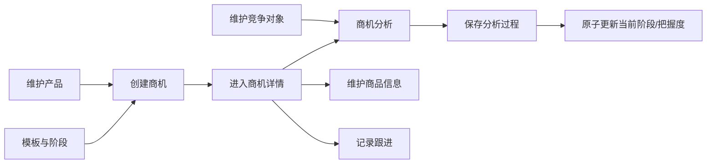
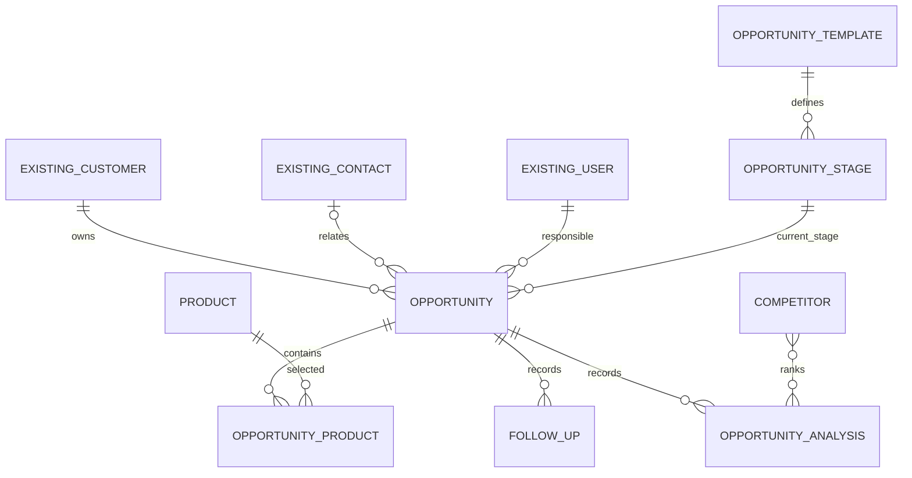

# 商机管理与销售过程记录需求说明书

> 版本：v0.1-draft  
> 状态：`awaiting-business-gate`  
> 来源：`REQSRC-058`  
> 适用项目：sdd-forge CRM 应用工程

## 1. 痛点与目标

| 痛点 | 目标 | 备注 |
|---|---|---|
| 当前已有客户、联系人和用户，但缺少把这些对象串成销售过程的商机聚合 | `BUS-022`：形成“客户—商机—商品—跟进—分析”的可追溯业务闭环 | 不重复建设客户、联系人和用户 |
| 固定阶段无法区分普通项目与招投标项目，也无法表达阶段客观赢率和销售主观判断 | 按商机模板维护专用阶段及固定阶段赢率，同时保存人工把握度 | 阶段不进入通用数据字典 |
| 分析会结论容易停留在口头或覆盖当前字段，无法复核判断过程 | 每次分析生成独立记录；阶段或把握度变化与分析记录原子保存 | 分析记录是业务过程记录，不是通用审计日志 |
| 商机商品和竞争对手没有受控来源 | 建立产品和竞争对象清单，并在商机中引用 | 产品、竞争对象停用后历史记录仍可读 |

## 2. 范围与优先级

### 2.1 本期范围

| 功能编码 | 功能说明 | 优先级 | 拟议切片 | 备注 |
|---|---|---|---|---|
| `FR-OPP-001` | 产品列表、新增、编辑、启停 | P0 | 017 | 商机商品的受控来源 |
| `FR-OPP-002` | 竞争对象列表、新增、编辑、启停 | P0 | 017 | 商机分析的受控来源 |
| `FR-OPP-003` | 商机模板、专用阶段和阶段赢率 | P0 | 017/018 | 初始化“公共”“招投标项目”；公共为默认模板 |
| `FR-OPP-004` | 商机列表和新增弹窗 | P0 | 018 | 保存成功直接进入详情 |
| `FR-OPP-005` | 商机信息详情与一对多商品信息 | P0 | 018 | 详情第一个 Tab |
| `FR-OPP-006` | 商机跟进记录 | P0 | 019 | 详情第二个 Tab |
| `FR-OPP-007` | 商机分析记录及当前阶段/把握度同步 | P0 | 020 | 详情第三个 Tab |
| `FR-OPP-008` | 商机阶段模板维护页面 | P1 | 021 | 数据模型本期建立；页面可在核心闭环后交付 |

### 2.2 本期明确复用、不重建

- 客户：复用当前 `crm_customer` 对象和客户 API；商机只保存引用，不直接修改客户。
- 联系人：复用当前 `crm_customer_contact`；选择联系人时必须校验其属于所选客户。
- 用户与员工：复用当前 `sys_user`、`org_employee`；销售负责人引用启用用户，不新增销售人员表。
- 角色、菜单、操作权限、列表视图：复用当前 RBAC、资源菜单和 list-view 底座。
- 页面样式：产品、竞争对象和商机列表沿用客户管理的查询区、工具栏、视图配置、表格和弹窗；商机详情沿用客户详情的多 Tab 工作区。

### 2.3 后置范围

| 功能 | 优先级 | 后置原因 |
|---|---|---|
| 赢单、丢单、重开及丢单原因 | P1 | 来自旧 MCRM 基线，但本次用户未要求进入三 Tab 首批交付 |
| 客户/商机负责人批量转交 | P1 | 需要独立的数据范围和批量失败策略规格 |
| 漏斗、经营仪表盘、预测汇总 | P2 | 本期先保证过程数据正确沉淀 |
| 报价、合同、订单、审批、附件 | P2 | 不属于本次商机过程记录范围 |

## 3. 业务解决方案

## 4. 系统功能

### PAGE-PROD-001 产品管理

入口：基本信息 / 产品管理。  
使用角色：拥有产品查看或维护权限的角色。

#### FR-OPP-001｜【新增】【P0】产品清单

- 页面采用客户管理列表模式，支持关键词、产品线、状态查询；序号、操作、产品编码按现有列表约定排列。
- 建议字段：产品 ID（系统生成、页面不显示）、产品编码、产品名称、型号、产品线、计量单位、状态、备注、版本和更新时间。
- 产品编码、产品名称必填；产品编码在租户内唯一。编码生成方式和产品线来源见 `Q-1703`、`Q-1704`。
- 新增、修改使用弹窗；被商机引用的产品不得物理删除，只能停用。
- 停用产品不能加入新的商机商品行，历史商机继续显示保存时的产品编码、名称和型号快照。

### PAGE-COMP-001 竞争对象管理

入口：基本信息 / 竞争对象。  
使用角色：拥有竞争对象查看或维护权限的角色。

#### FR-OPP-002｜【新增】【P0】竞争对象清单

- 页面采用客户管理列表模式，支持名称、行业地位、所在地、状态查询。
- 业务字段：竞争对手 ID（系统生成、页面不显示）、竞争对手名称、行业地位、所在地、主要产品、优势、劣势；增加状态、备注、版本和更新时间作为生命周期字段。
- 竞争对手名称必填，建议在租户内按去除首尾空格、忽略大小写后唯一。
- 新增、修改使用弹窗；被分析记录引用后不得物理删除，只能停用。
- 停用竞争对象不能用于新分析，历史分析仍显示名称快照。

### PAGE-STAGE-001 商机模板与阶段

#### FR-OPP-003｜【新增】【P0】模板、阶段及固定赢率

- 商机模板独立保存，初始化“公共”“招投标项目”，状态均为启用；新建商机默认选“公共”。
- 商机阶段独立保存并关联一个模板，不使用通用数据字典；同一模板内按显示序号排序。
- 每个阶段维护阶段名称、阶段编码、阶段赢率（0%～100% 的整数）、是否默认阶段、显示序号和状态。
- 同一模板只能有一个启用的默认阶段；新建商机自动使用所选模板的默认阶段。
- 商机当前阶段必须属于其当前模板。切换模板时的处理规则见 `Q-1707`。
- 模板或阶段停用后不可用于新建/变更，历史商机和分析记录继续显示快照。

### PAGE-OPP-001 商机列表

#### FR-OPP-004｜【新增】【P0】商机查询与快速新建

- 列表交互沿用客户管理：默认一行查询、更多条件、显式查询/重置、当前视图/设置、总数、刷新和服务端分页。
- 默认查询条件：商机编码或名称、客户、模板、阶段、销售负责人、状态；列配置继续使用 list-view 能力。
- 建议默认列：序号、操作、商机编码、商机名称、客户、模板、阶段、阶段赢率、把握度、销售负责人、确认日期、预签日期、预签金额、状态、更新时间。
- 点击新增打开快速新建弹窗；保存成功后关闭弹窗并直接打开该商机详情。
- 快速新建至少录入：商机名称、客户、联系人、销售负责人、模板、阶段、把握度、确认日期；模板默认“公共”，阶段随模板默认，负责人默认当前用户。
- 联系人可空；选择后必须属于当前客户。销售负责人必须为当前租户内启用且可承担销售责任的用户。

### PAGE-OPP-002 商机详情

页面固定三个一级 Tab：商机信息、跟进记录、商机分析记录。

#### FR-OPP-005｜【新增】【P0】商机信息与商品信息

- 商机信息字段沿用旧业务基线并加入模板/把握度：商机编码、名称、客户、联系人、销售负责人、来源、模板、当前阶段、阶段赢率（只读）、把握度、确认日期、预签日期、客户预算、预签金额、合作伙伴、状态和备注。
- 商机 ID、编码、阶段赢率只读；把握度为人工录入的 0%～100% 整数，不由阶段赢率自动覆盖。
- 商品信息位于基本信息下方，是一对多表格；可从启用产品中选择多个商品。
- 每行保存产品引用及编码/名称/型号快照、数量、销售单价、预计金额、需求说明。数量为正数，单价为人民币含税非负金额，预计金额按数量×单价计算并保留两位小数。
- 产品停用不影响历史行展示；新建或更换产品时只能选启用产品。同一产品是否允许多行见 `Q-1708`。
- 客户预算、预签金额与商品预计金额暂不强制相等，也不自动回写。

#### FR-OPP-006｜【新增】【P0】跟进记录

- 第二个 Tab 按时间倒序展示跟进记录，支持新增、编辑和逻辑停用。
- 字段：跟进时间、跟进人、工作事项、结果/下一步、状态、版本和更新时间。
- 跟进时间必填，默认当前时间且可修改；跟进人默认当前用户，只能选择对该商机有访问权的启用用户；工作事项必填。
- 跟进记录继承商机的数据范围，不能通过记录 ID 绕过商机授权。

#### FR-OPP-007｜【新增】【P0】商机分析记录

- 第三个 Tab 按分析时间倒序展示过程记录；点击新增后一次完成一条分析。
- 分析表单展示商机名称（只读），允许填写/选择：商机阶段、商机把握度、主要竞争对手 1、主要竞争对手 2、当前机会点、项目风险情况、下一步计划、备注。
- 两个竞争对手均可空；同时选择时不得相同，只能选择启用竞争对象。
- 保存分析时始终新增一条过程记录，并保存商机名称、阶段名称、阶段赢率、把握度和竞争对手名称快照，以及分析人和分析时间。
- 如果分析中的阶段或把握度与商机当前值不同，新增分析记录和更新商机当前值必须在同一事务内成功或全部失败。
- 并发版本不一致时拒绝保存并提示刷新；不得只写分析记录却未更新商机，或只更新商机却未保留分析过程。
- 建议分析记录保存后不可编辑或删除，以保持会议判断链；最终规则见 `Q-1705`。

#### FR-OPP-008｜【新增】【P1】阶段模板维护

- 在核心商机闭环稳定后提供模板/阶段管理页，支持查询、阶段排序、阶段赢率、默认阶段和启停维护。
- 已被商机或分析记录引用的模板/阶段不得物理删除；修改名称或赢率只影响后续选择，历史分析继续使用快照。
- 阶段编码发布后不可修改，避免历史集成和规则失效。

#### 2026-09-24 页面结构变更

- 商机阶段管理取消左模板树/右阶段表的主从布局，改为单一表格管理页面。
- 查询区第一项为“商机模板”下拉框，值为“公共”“招投标项目”，默认选择“公共”。切换模板后按模板过滤阶段列表。
- 阶段列表保留阶段编码、名称、赢率、默认阶段、显示序号、状态及新增/编辑/删除能力；模板是阶段的必填归属字段，但不在本页提供模板树维护。

## 5. 跨功能公共要求

### 5.1 权限和数据范围

- 所有页面、按钮和 API 都通过当前角色权限体系授权，不按账号名特判。
- 建议权限点至少区分：产品查看/维护、竞争对象查看/维护、商机查看/新增/修改、商品维护、跟进维护、分析新增、阶段配置。
- 商机、商品、跟进和分析共享同一商机数据范围；子对象不得扩大父商机的可见范围。
- 商机列表和详情的行级范围建议按销售负责人和当前角色数据策略解析，具体规则见 `Q-1706`。

### 5.2 状态、删除和历史

- 产品、竞争对象、模板、阶段、商机及子记录使用启用/停用或业务状态，默认不物理删除已被引用的数据。
- 阶段、产品、竞争对象等易变名称在交易明细或过程记录中保存必要快照，避免历史展示随主数据改名而失真。
- 所有写操作使用乐观并发版本并写入当前 `sys_audit_log`；审计日志不得保存密码、Token 或不必要的完整敏感内容。

### 5.3 桌面交互

- 桌面优先、中文界面、项目全局字体；查询按钮、工具栏、表格密度、反馈和弹窗与客户管理保持一致。
- 商机详情复用当前多 Tab 路由工作区；刷新或直接打开详情 URL 后，应恢复目标商机和当前 Tab。

## 6. 验收方向

- `AC-1701`：产品和竞争对象可维护、可停用；停用对象不能新选但历史引用正常显示。
- `AC-1702`：系统存在“公共”“招投标项目”两个模板；公共为新商机默认模板，阶段和赢率来自专用阶段数据而非字典。
- `AC-1703`：用户可从商机列表弹窗新建，保存后自动进入详情；客户、联系人、负责人均引用现有对象并通过作用域校验。
- `AC-1704`：商机信息 Tab 可维护多条商品行，金额计算、产品停用和并发冲突行为正确。
- `AC-1705`：跟进记录只在有商机访问权时可读写，跟进人和时间规则正确。
- `AC-1706`：每次分析新增独立记录；改变阶段或把握度时，记录与商机当前值原子一致。
- `AC-1707`：viewer 或无对应操作权限的用户不能通过直接 API 写入产品、竞争对象、商机及其子对象。

## 7. Gate 边界

当前为 Business Gate 草案。批准后允许按 `slice-map.md` 逐片形成 Specification 和测试设计；在各切片 Specification/Architecture Gate 获得批准前，不创建实现任务、不修改数据库、不编码，也不声明 Release。

## 2026-10-04 编码规则当前有效变更

来源REQSRC-097。新建编码统一由[编码规则当前规格](../013-numbering-rules/requirement.md)及036切片负责，替代本文中原有硬编码前缀/日期/流水或手填员工工号的描述；历史记录不改号。客户CUSTOMER默认C+7位、员工EMPLOYEE默认1+6位、商机OPPORTUNITY默认OP+年月日+5位、报价QUOTATION默认QT+年月日+5位、订单SALES_ORDER默认SO+年月日+5位、入库INBOUND默认IB+年月日+5位、销售出库OUTBOUND默认OB+年月日+5位。实际生成以当前启用规则为准，更新不重新取号；缺失/停用规则阻止新建，不回退旧算法。验收映射为036的REQ-NUM-06/AC-NUM-06/TC-NUM-06；未涉及本模块的对象仅作统一规则说明，不扩大功能范围。

## 2026-10-06 演示数据基线

来源 `REQSRC-106`。商机、商机产品、跟进和报价演示数据统一由 `016-demo-data-rebuild` 重建；每个商机业务状态和启用阶段至少 5 条，引用当前启用的规范产品，编码和金额按当前规则生成。该基线不改变商机状态机。
