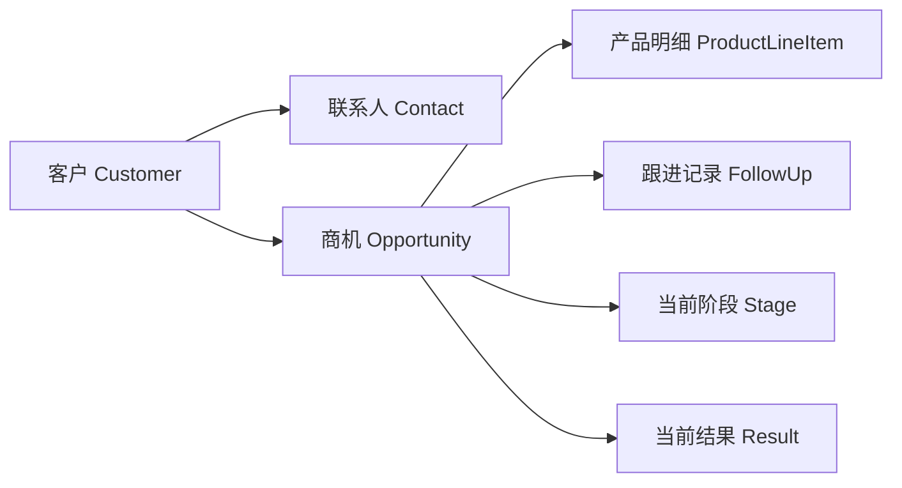

# MCRM 业务需求说明书（业务视角）

> 本文档是 **`../../.specify/requirements/001-opportunity-management/requirement.md` V2.0 的派生视图**。
> 定位：把已批准基线中的**业务对象与业务规则**单独抽出，便于产品开发和业务讨论时直接阅读。
> **冲突处理：凡本文与原 V2.0 基线不一致，一律以原 V2.0 基线及其 `conflict-decisions.md` 为准。**
>
> 范围声明：本文**只讲业务**。登录、用户档案、角色（销售/经理/总监）、部门、数据范围、密码策略等系统管理与权限机制不在本文范围，统一见系统管理侧文档；本文只在必要处保留"销售负责人"这一业务字段。

---

## 1. 业务背景与目标

- 面向企业客户（B2B 项目型销售），不含个人客户。
- 用最少的业务对象打通：客户 → 联系人 → 商机 → 产品金额 → 阶段与跟进 → 赢/丢单。

| 指标 ID | 指标 | 基线 | 目标 | 口径 |
|---|---|---:|---:|---|
| OBJ-001 | 新商机个数 | 21 个/月 | 30 个/月 | 按"商机确认日期"归属月份，统计当月确认的商机数 |
| OBJ-002 | 商机转化率 | 23% | 31% | 按季度统计结果形成日期落在季度内的商机：赢单数 ÷（赢单 + 丢单） |
| OBJ-003 | 销售人均跟进记录数 | 18 条/人/月 | ≥30 条/人/月 | 销售角色启用用户每人每月填写的跟进记录数 |

> MVP 只保证上述指标所需数据能正确记录和复核，不建设经营分析仪表盘。

---

## 2. 业务对象总图

业务闭环：一个客户下有多个联系人、多个商机；一个商机下有多条产品明细和多条跟进记录，并记录当前阶段与当前结果。

---

## 3. 客户管理

### 字段

| 字段 | 规则 |
|---|---|
| 客户 ID | 系统生成、只读、全局唯一 |
| 客户名称 | 必填；去除首尾空格后做不区分大小写的唯一校验 |
| 客户简称 | 可选 |
| 销售负责人 | 必填；只能选启用的销售用户 |
| 行业、来源、客户级别 | 可选，固定选项 |
| 公司电话、地址、备注 | 可选 |
| 状态 | 正常 / 已删除 |

### 业务规则

- 支持列表查询、新增、详情、编辑、逻辑删除。
- 客户名称重复时提示具体冲突并阻止保存；**已删除客户仍占用原名称**。
- 一个客户可关联多个联系人和多个商机。
- 客户不冗余保存部门或销售中心，数据归属通过销售负责人计算。

---

## 4. 联系人管理

| 字段 | 规则 |
|---|---|
| 联系人 ID | 系统生成、只读、全局唯一 |
| 所属客户 | 必填 |
| 姓名 | 必填 |
| 性别、职务 | 可选 |
| 联系方式 | 可选；电话、手机或邮箱 |
| 备注 | 可选 |
| 是否决策人 | 必填，默认否 |
| 状态 | 正常 / 已删除 |

- 在客户详情内查询、新增、编辑、逻辑删除。
- 联系人不单独设负责人、不分类、不设默认/主联系人。
- 联系方式重复可提示，不阻止保存。

---

## 5. 商机基础信息

| 字段组 | 字段与规则 |
|---|---|
| 标识 | 商机 ID、商机编号由系统生成、只读；商机名称必填 |
| 关联 | 企业客户必填；联系人可选，且必须属于所选客户 |
| 归属 | 销售负责人必填，只能选启用的销售用户 |
| 分类 | 商机来源可选，固定选项 |
| 阶段与结果 | 当前阶段必填；结果为 `null` / 赢单 / 丢单 |
| 日期 | 商机确认日期必填且可编辑；预签日期可选；结果形成日期由系统维护 |
| 金额 | 客户预算、预签金额可选；人民币、两位小数、不得小于 0 |
| 补充信息 | 竞争对手、竞争分析、合作伙伴、备注均可选 |
| 状态 | 正常 / 已删除 |

- 支持商机列表查询、新增、详情、编辑、逻辑删除。
- 新建商机默认：负责人 = 当前销售用户，阶段 = "初始线索"，结果 = `null`。
- **商机确认日期决定 OBJ-001 的归属月份**，修改它会影响对应月份统计。

---

## 6. 固定六阶段

阶段顺序**固定**为：

1. 初始线索
2. 客户需求确认
3. 技术认可
4. 报价
5. 商务谈判
6. 合同签订

业务规则：

- 阶段里程碑只提示，不强制校验。
- **允许跨级推进，也允许一次回退多个阶段。**
- MVP 只保存当前阶段，不提供阶段配置、把握度、阶段变更历史。
- 进入"合同签订"时，若结果仍为 `null`，系统**自动置为赢单**并记录结果形成日期。
- 已有结果时改阶段不自动覆盖结果；从"合同签订"回退也不自动清空结果，需用"重开商机"。

---

## 7. 产品线与产品明细

### 产品线（独立清单）

- 字段：产品线 ID、名称、显示顺序、启用状态。
- 支持新增、查询、编辑、排序、启停；停用项不可新选，历史数据继续显示。
- 不建设产品主数据和产品编码。

### 商机产品明细

| 字段 | 规则 |
|---|---|
| 产品线 | 必填，选启用产品线 |
| 产品名称 | 必填，自由文本，允许临时产品 |
| 型号 | 可选，自由文本，不受主数据管控 |
| 数量 | 必填，大于 0 的整数 |
| 销售单价 | 必填，人民币含税价，≥0，两位小数 |
| 预计金额 | 系统计算 = 数量 × 销售单价，两位小数 |
| 需求说明 | 可选 |

- 一个商机可有多个产品明细行，允许同一产品出现多行。
- 客户预算、预签金额、产品预计金额之间**不联动、不强制校验**。
- 不维护税率和其他币种。

---

## 8. 跟进记录

| 字段 | 规则 |
|---|---|
| 跟进 ID | 系统生成 |
| 商机 | 必填 |
| 跟进时间 | 必填，默认当前时间，可修改 |
| 跟进人 | 默认当前用户，只能选有该商机访问权的启用用户 |
| 工作事项 | 必填 |
| 结果/下一步 | 可选 |

- 在商机详情内新增、查询、编辑、逻辑删除。
- 用于 OBJ-003 统计：按跟进时间和跟进人归属月份及人员。
- 不建设独立拜访、工作计划、待办、完成状态和附件。

---

## 9. 商机结果

- 结果枚举固定：`null` / 赢单 / 丢单；阶段与结果分别记录。
- 可手工设置赢单或丢单；设置时系统记录结果形成日期。
- **丢单必填丢单类别和原因**；类别固定为：价格、技术、关系、商务、其他。
- 丢单信息允许编辑，无审批流程。
- **赢单和丢单均可重开**：重开将结果改回 `null`，清空结果形成日期和丢单信息。
- 不记录结果变更历史，不做赢丢单分析/原因统计/复盘。
- OBJ-002 按当前结果和当前结果形成日期计算；编辑结果或重开会改变统计。

---

## 10. 客户与商机负责人批量转交

- 客户和商机在各自列表分别勾选、分别转交，不提供跨对象一次性转交。
- 转交目标只能是一个启用的销售用户。
- 执行后只改所选对象的销售负责人。
- **转交客户不自动转交其下商机；转交商机不改客户负责人**（无隐式级联）。
- 联系人不单独转交，归属随客户。
- 不建设转交原因、审批、转交记录和转交日志。

---

## 11. 通用业务规则

- 系统生成 ID 不允许用户编辑。
- 必填、枚举、金额、日期格式错误时阻止保存并给出明确提示。
- 逻辑删除数据默认不出现在业务列表和指标中；唯一性占用规则按各对象定义执行。
- 业务对象保留创建时间、更新时间（用于系统运行），不提供审计查询或变更对比。
- 金额：人民币、两位小数、单价含税、数量为正整数。
- MVP 枚举全部使用固定选项，不做数据字典配置页。
- 桌面 Web、中文界面。

---

## 12. 明确不做（MVP 边界）

- 多级组织、独立员工、多角色、菜单/按钮权限配置；
- 产品主数据、报价单、报价审批、合同、订单；
- 独立拜访、工作计划、待办、复盘、行动计划；
- 可配置商机阶段、阶段把握度、阶段变更记录；
- 赢丢单分析、经营分析、漏斗、仪表盘；
- 数据字典管理页面；
- 附件上传与管理；
- 通用操作日志、审计日志及查询；
- 移动端、Excel 数据迁移、SSO、外部系统集成。

---

## 13. 业务验收要点

1. 重复客户无法保存，客户下能维护联系人；
2. 销售能创建含产品明细的商机，并修改六阶段；
3. 到达"合同签订"可自动形成赢单，丢单可登记类别与原因，结束后可重开；
4. 能新增和维护跟进记录；
5. 客户和商机可分别批量更换销售负责人，且不发生隐式级联；
6. 三个业务指标（OBJ-001/002/003）所需字段和口径均可从业务数据复核；
7. 系统不存在通用日志、阶段日志、附件、拜访、报价、经营分析入口。

---

> 页面级行为和可执行验收场景，以原 V2.0 基线下各纵向切片的 Specification Gate 文档为准。
