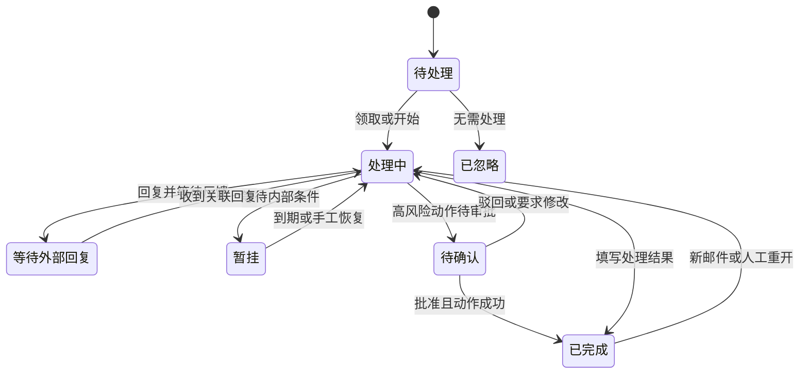

# 数字员工任务闭环规划

## 1. 规划结论

数字员工发现的邮件、预警、异常、报表偏差等内容，使用统一的任务技术底座承载编号、负责人、状态、时间线和审计；分派、处理、时限、预警和完成规则由每个数字员工场景独立定义。邮件是来源证据，邮件任务的具体闭环由邮件场景策略负责，不作为其他数字员工的默认策略。

不建议把以下概念混在一个状态字段中：

- **处理状态**：任务当前走到哪一步。
- **关注程度**：普通、重要、紧急或星标。
- **业务标签**：订单、投诉、交期、质量、付款等分类。
- **处理结果**：已回复、无需处理、转交业务、重复任务等结论。
- **邮件状态**：邮件是否已读、归档、移至回收站或已发送回复。

采用该分层后，一封邮件可以已经读过但任务仍未完成；任务可以暂挂但仍然保持特别关注；发送回复后可以等待客户反馈；任务完成后也能保留全过程记录。

## 2. 行业做法及对本项目的启示

### 2.1 工作队列与责任人

Dynamics 365 使用队列集中承载需要处理的工作项，并支持领取、分派、转交和按优先级监控。对本项目的启示是：数字员工任务必须有当前责任人或责任队列，不能只显示“系统管理员”。

### 2.2 待外部回复与内部暂挂分开

Zendesk 将等待请求人回复的 `Pending` 与等待内部第三方信息的 `On-hold` 分开；收到请求人回复后，任务可重新进入处理中。对本项目的启示是：邮件“已回复”通常不是完成，而是进入“等待对方回复”；“暂挂”必须有原因和恢复时间。

### 2.3 关注、提醒和完成分离

Outlook 用跟进标志和提醒管理需要再次处理的邮件，并区分“标记完成”和“清除标志”；Gmail 也将星标、标签、暂缓和添加到任务作为不同操作。对本项目的启示是：特别关注、标签、提醒时间均不应改变任务状态。

### 2.4 SLA、预警与升级

Dynamics 365 的 SLA 支持警告时间、失败时间、暂停和恢复；Salesforce 支持超时后重新分派和通知。对本项目的启示是：数字员工的预警应由响应时限和完成时限驱动，并可升级到负责人、上级或业务队列。

### 2.5 人工接管

成熟的自动化平台将自动动作与人工确认放在同一任务链路中。低风险分类、摘要和内部标签可自动完成；对外回复、删除、业务写入等动作根据规则进入人工确认。

## 3. 目标状态模型

建议使用以下主状态：

| 状态 | 含义 | 典型进入方式 |
|---|---|---|
| 待处理 | 数字员工已发现并建立任务，尚未领取 | 自动创建 |
| 处理中 | 责任人已领取或开始处理 | 开始处理、自动分派 |
| 等待外部回复 | 已向发件人回复，等待对方反馈 | 回复邮件后选择“等待回复” |
| 暂挂 | 因内部资料、审批、第三方或约定日期无法继续 | 暂挂并填写原因、恢复时间 |
| 待确认 | 数字员工已生成建议或动作，等待人工审批 | 自动回复草稿、删除请求、业务写入请求 |
| 已完成 | 已形成明确处理结论 | 人工完成或满足可审计自动完成规则 |
| 已忽略 | 垃圾、重复、无需业务处理 | 忽略并选择原因 |
| 已取消 | 来源撤销或任务不再成立 | 管理员取消 |

关键流转：

## 4. 页面规划

### 4.1 工作台“需要我处理”

工作台保留任务列表，并增加：

- 星标/特别关注。
- 状态、优先级、标签、责任人、来源、下一提醒时间和 SLA 剩余时间。
- 行快捷操作：开始处理、暂挂、标记完成、更多。
- 默认只显示仍需处理的任务；已完成、已忽略通过筛选查看。

列表中的“任务编号”进入任务详情，不在列表中堆叠回复、备注等复杂动作。

### 4.2 统一任务详情

任务详情建议使用工作区内详情页面或右侧抽屉，包含：

1. **顶部摘要**：任务名称、状态、优先级、星标、责任人、截止时间。
2. **来源证据**：邮件主题、发件人、摘要、收到时间及查看原邮件入口。
3. **建议动作**：数字员工的分类、风险判断、处理建议和置信信息。
4. **处理工具栏**：回复、转派、暂挂、添加标签、标记完成、忽略。
5. **协作区**：内部备注、附件、处理人变更和 @ 提醒。
6. **处理时间轴**：自动分类、领取、备注、回复、暂挂、恢复、预警、完成和重新打开均留痕。

### 4.3 邮件处理页

“邮件自动化设置 → 邮件处理”保留为邮件专业视图，但操作统一调用任务闭环：

- 查看原邮件和关联任务。
- 生成回复草稿、编辑并发送。
- 标记特别关注、添加标签和备注。
- 暂缓到指定日期。
- 标记已处理或忽略。
- 请求移入回收站。

邮件页不再独立维护一套与工作台冲突的处理结论；状态变化应同步显示在工作台任务中。

## 5. 邮件数字员工闭环案例

### 5.1 新订单邮件

1. 邮件数字员工收取邮件，识别为“订单处理”，建立任务并关联原邮件。
2. 根据客户等级和交期关键词设置优先级、标签和响应时限。
3. 责任人在工作台打开任务，查看摘要、附件和建议动作。
4. 责任人可编辑数字员工生成的回复草稿并发送。
5. 若需要客户补充资料，任务进入“等待外部回复”；新回复到达时自动恢复“处理中”并提醒责任人。
6. 订单录入完成后，责任人选择处理结果“已转销售订单”，关联销售订单并完成任务。

### 5.2 质量投诉邮件

1. 自动标记“特别关注”“质量投诉”“高风险”，分派到质量队列。
2. 在首次响应时限前预警；超时自动通知责任人和质量负责人。
3. 回复客户已受理后，任务可以暂挂为“等待质量分析”，并记录恢复时间。
4. 质量报告或 8D 记录形成后再次进入处理中。
5. 最终回复发送成功并关联质量记录后完成；后续客户再次回复时允许重新打开。

### 5.3 无需处理邮件

通知、广告或重复邮件可以选择“忽略”，但必须保存忽略原因。规则置信度足够且风险低时可自动忽略；自动忽略结果应可查询、恢复和审计。

## 6. 完成任务的规则

“标记完成”不等于删除邮件，也不等于仅写一个完成状态。建议至少形成：

- 处理结果类型。
- 一条处理结论或关联业务记录。
- 完成人和完成时间。
- 已执行动作及其结果，例如回复邮件发送成功。

不同任务类型可配置完成条件：

- 一般咨询：回复成功即可完成。
- 等待客户资料：回复成功后进入等待外部回复，不自动完成。
- 订单邮件：关联销售订单后完成。
- 质量投诉：关联质量事件并完成最终回复后完成。
- 无需处理：选择忽略原因后关闭。

## 7. 预警与暂挂规则

- 每个任务可有首次响应时限、完成时限和下一提醒时间。
- 特别关注只是醒目标记，不改变状态。
- 暂挂必须选择原因和恢复时间；到期自动回到待处理或处理中。
- 等待外部回复期间可暂停完成 SLA，但可单独设置客户未回复提醒。
- 临近超时显示黄色预警，超时显示红色预警，并按规则通知或升级。
- 自动动作失败应生成异常事件，不得把任务错误地标记为已完成。

## 8. 与当前系统的差距

当前系统已具备任务列表、开始处理、确认完成，以及邮件的完成、忽略、回复和删除动作。后续需要补齐：

1. 统一工作台任务和邮件处理记录，避免两套状态不一致。
2. 增加特别关注、优先级、标签、内部备注和处理时间轴。
3. 增加等待外部回复、暂挂、恢复和重新打开。
4. 增加责任人/队列、转派、SLA、预警和升级。
5. 回复编辑应在任务详情完成，并记录模板、实际内容、发送结果和关联邮件。
6. 标记完成时保存处理结果；有业务对象的任务支持关联销售订单、质量事件等记录。

## 9. 建设顺序

### 第一阶段：可关闭、可追溯

- 统一任务详情。
- 完成、忽略、备注、标签、星标、暂挂和恢复。
- 邮件处理页与工作台任务同步。
- 所有动作进入时间轴。

退出标准：任一邮件任务都能说明“谁在什么时候依据什么完成了什么处理”。

### 第二阶段：可协同、可预警

- 责任队列、领取、转派和协作备注。
- 响应/完成 SLA、提醒、超时升级。
- 等待外部回复及新回复自动重开。

退出标准：任务不会因责任不清或暂挂后遗忘而长期无人处理。

### 第三阶段：按规则自动闭环

- 按任务类型配置完成条件。
- 低风险自动忽略和自动归档。
- 对外回复、删除和业务写入继续受权限、白名单和人工确认控制。
- 统计自动完成率、人工接管率、重开率、超时率和误处理率。

退出标准：自动化节省时间可衡量，同时所有结果可审计、可恢复、可人工接管。

## 10. 参考资料

- [Microsoft Dynamics 365：队列用于组织、分派和监控工作项](https://learn.microsoft.com/en-us/dynamics365/customer-service/use/work-with-queues)
- [Microsoft Dynamics 365：SLA 警告、暂停和恢复](https://learn.microsoft.com/en-us/dynamics365/customer-service/administer/define-service-level-agreements)
- [Salesforce Service Cloud：超时升级、重新分派和通知](https://resources.docs.salesforce.com/latest/latest/en-us/sfdc/pdf/support.pdf)
- [Zendesk Agent Guide：Pending、On-hold 与回复后恢复处理](https://cdn.zendesk.com/resources/documentation/Zendesk_Agent_Guide.pdf)
- [Microsoft Outlook：跟进标志、提醒和标记完成](https://support.microsoft.com/en-us/outlook/flag-email-messages-for-follow-up)
- [Gmail：星标、暂缓、标签及添加到任务](https://support.google.com/mail/answer/2473038)
- [Microsoft：工作流与 Agent 中的 Human in the Loop](https://learn.microsoft.com/en-us/connectors/advancedapprovals/)
