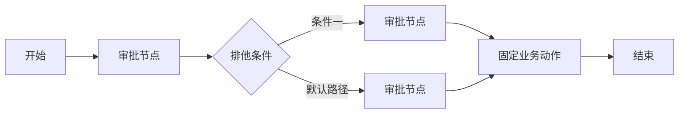
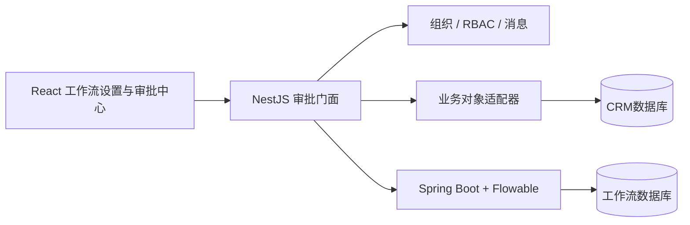

# Forge CRM 受控审批工作流方案

> 版本：v0.4 · 2026-10-06  
> 定位：面向业务单据的常规串行审批，不建设通用低代码工作流平台。  
> 当前实现：Flowable OSS 独立引擎、CRM 审批门面、销售订单真实审批切片和受控工作流设置已经完成；其他业务对象按接入契约逐项扩展。

## 1. 本次重新设计的结论

本系统需要解决的是销售订单、报价单、付款申请、报销、请假及异常事件等业务记录的常规审批。现阶段以“能够稳定配置和执行串行审批”为完成标准，不以复制简道云全部低代码能力为目标。

工作流采用以下受控模型：

它必须满足：

- 按业务对象创建工作流，条件字段只能来自该对象登记的字段目录。
- 支持开始、审批、排他条件、固定业务动作和结束节点。
- 支持串行审批和排他条件分支；每次只进入一条确定路径。
- 支持部门经理、明确的上级部门负责人、财务负责人和登记的固定职责。
- 支持同意、退回申请人、驳回终止和受控转交。
- 支持审批中心、站内待办、审批记录、完整流程图和原单据底部的审批区域。
- 支持不可变发布版本、运行实例版本快照、可靠业务动作和失败恢复。

## 2. 明确不纳入当前范围

以下能力不是当前工作流是否可用的前提，本方案不为它们预留虚假入口：

- 节点字段可见、可编辑、必填权限和子表行操作权限。
- 会签、或签、顺序会签及同一节点多人共同审批。
- 并行分支、并行汇聚和多实例任务。
- 前加签、后加签、动态插入审批人。
- 抄送节点、抄送我的、流程委托、催办和主动撤回。
- 超时自动提交、自动退回和复杂工作日历。
- 子流程、DMN、CMMN、任意 BPMN/XML、脚本、SQL、URL 或 Java 类配置。
- 节点内直接编辑原单据字段和审批人自定义回写表达式。
- 简道云式自由拖拽 BPMN 画布、任意回跳和运行中改造流程结构。

未来只有出现明确业务场景并完成独立规格、权限与并发验证后，才增加上述能力。

## 3. 适用场景

| 场景 | 条件示例 | 串行路径示例 | 完成动作 |
| --- | --- | --- | --- |
| 销售订单 | 折扣后金额、订单类型、法人 | 部门经理 → 超额时二级部门负责人 → 财务 | 审核销售订单 |
| 报价申请 | 折扣、金额、是否非标 | 销售负责人 → 条件命中时财务或技术负责人 | 标记内部审批通过 |
| 付款申请 | 法人、金额、付款类型 | 部门负责人 → 财务负责人 → 授权负责人 | 形成可支付状态，不直接完成银行付款 |
| 报销 | 金额、费用类型 | 部门经理 → 超额时上级负责人 → 财务 | 形成已核定报销记录 |
| 请假 | 假别、天数 | 部门经理 → 长假时上级负责人 → HR职责人 | 形成已批准休假记录 |
| 异常事件 | 严重度、损失金额、事件类型 | 调查 → 整改 → 复核 → 财务处置 → 关闭 | 执行登记的事件业务动作 |

不同业务对象可以使用相同工作流底座，但必须分别登记字段、状态机、提交快照、业务动作和授权规则。销售订单已完成真实接入，不表示其他对象已经可直接启用。

## 4. 流程定义模型

### 4.1 工作流属性

每个工作流包含：

- 工作流 ID、编码、名称、业务对象、说明。
- 当前版本、状态、创建人、创建时间、更新人、更新时间。
- 草稿、发布中、已发布、发布失败、已停用等管理状态。
- 一个对象在同一租户和应用范围内只能有一个启用发布版本。

业务对象在首次保存后不可更换。需要改用其他对象时新建工作流，防止字段条件和业务动作失去含义。

### 4.2 节点类型

| 节点 | 用途 | 主要配置 |
| --- | --- | --- |
| 开始 | 流程唯一入口，系统生成且不可删除 | 名称 |
| 审批 | 创建一个待办，由一个解析后的负责人处理 | 名称、审批职责、是否允许转交、说明 |
| 排他条件 | 按业务字段选择唯一后续路径 | 有序条件、默认路径 |
| 业务动作 | 调用开发人员登记的固定业务命令 | 动作编码、版本、允许的参数映射 |
| 结束 | 流程出口，系统生成且不可删除 | 名称、结束结果 |

审批人按提交时的申请组织和当前发布版本解析并冻结。首期负责人来源为部门经理、明确配置的上级部门负责人、财务负责人以及对象允许的固定职责。解析不到唯一有效负责人时阻止提交，不自动同意，也不猜测人员。

### 4.3 条件规则

条件使用服务端登记的结构化 AST：字段、运算符、定型值、AND/OR 条件组。浏览器不能提交自由表达式。

- 每个排他条件节点必须有且只有一条默认路径。
- 非默认路径必须配置合法条件和稳定顺序。
- 按顺序匹配第一条成立路径；均不成立时进入默认路径。
- 空值、币种和日期口径由对象字段目录定义，不作隐式转换。
- 路由所依据的数据在提交时形成快照，审批过程中修改原单据不能改变本轮路径。

## 5. 设计页面

### 5.1 工作流列表

系统管理 → 工作流设置首先进入查询表格列表。查询条件为名称或编码、数据对象、状态；表格显示编码、名称、数据对象、最新版本、状态、创建人和创建时间，并使用统一分页。

新增使用弹窗，只填写工作流名称和数据对象。确定后生成 V1 草稿以及不可删除的开始、结束节点，再进入详情设计页。

### 5.2 受控可视化设计

设计页使用“流程图 + 节点属性”的方式，但不建设自由 BPMN 画布：

- 中间区域始终显示完整流程结构；系统自动排列节点和连线。
- 点击节点，在右侧编辑该节点允许的属性。
- 在节点或连线上通过“新增”选择审批节点、条件分支或业务动作。
- 条件分支以图形方式显示条件名称和默认路径。
- 支持缩放、适应画布、定位当前选中节点；不支持任意坐标拖动和交叉连线。
- 设计预览、审批详情和原单据运行图复用同一个流程图组件和相同节点语义。

正式页面已采用上述受控图形编排；节点、连接线和条件仍保存为原结构化设计模型，因此没有改变现有安全编译、发布校验和运行协议。

### 5.3 保存、校验和发布

草稿可保存未完成状态。发布时必须检查：

1. 开始和结束节点唯一且完整连接；
2. 所有节点从开始可达并最终能够到达结束；
3. 审批职责有效且能够解析人员；
4. 排他分支只有一个默认路径，其他路径条件合法；
5. 业务动作在当前对象的动作目录内且版本有效；
6. 条件字段、类型、运算符和值与对象字段目录一致；
7. 不存在非法循环、孤立节点和无出口路径。

发布版本不可原地修改或删除。编辑已发布流程时复制为下一草稿版本；新实例使用新版本，运行中和历史实例继续使用启动时版本和图快照。

## 6. 运行时审批

### 6.1 状态分离

系统分别保存：

- 流程状态：启动中、审批中、已退回、已通过、已驳回、执行失败。
- 业务单据状态：由销售订单、报价、付款等模块自行定义。
- 技术执行状态：待投递、处理中、重试中、失败待处理、完成。

审批人员全部同意但最终业务动作失败时，不能把单据显示为已审核；页面应显示“审批已同意，业务执行失败”，等待可靠重试或管理员处理。

### 6.2 审批动作

| 动作 | 规则 |
| --- | --- |
| 同意 | 校验当前任务、承办人、权限和版本后推进流程 |
| 退回申请人 | 结束当前轮次，撤销本轮待办，单据回到允许修订状态；重新提交创建新轮次 |
| 驳回终止 | 结束当前轮次并记录必填原因；能否再次申请由业务对象决定 |
| 转交 | 只能转给当前版本配置的同职责备选人，并记录原负责人、接收人和原因 |

审批接口必须防重复点击和网络重放。同一个任务只有第一个合法动作生效，后续请求返回已经处理的结果。

### 6.3 审批中心和原单据

工作台顶部进入审批中心，当前范围包括“我的待办、我的已办、我发起的”。待办显示流程、业务单号、申请人、申请部门、当前节点、到达时间和状态。

审批执行页显示业务快照、完整流程图、当前节点、审批记录和允许的处理按钮。原业务单据保持原有主表、明细和附件结构，在页面最下方追加工作流区域；未发起时显示“尚未发起审批”。

运行图必须绑定实例启动时的定义版本：未命中分支仍保留但弱化，当前、完成、退回、驳回和执行失败使用不同状态标识。点击节点可查看处理人、操作、意见和时间。

## 7. 组织、权限和审计

- 流程设置、发布、审批处理和异常恢复分别使用菜单与动作权限。
- 能查看业务单据不等于能审批；能看到审批区域也不产生任务处理权。
- 申请人必须关联启用员工、有效任职和申请组织。
- 默认禁止申请人审批自己的申请；如业务未来需要例外，必须单独定义和留痕。
- 所有操作记录租户、应用、业务对象、单据、流程版本、轮次、节点、操作者、动作、意见和时间。
- 历史只追加，不因人员调岗、流程停用或新版本发布而改写。

## 8. 业务动作和可靠性

工作流只能选择开发人员登记的固定业务动作，例如 `sales.order.approve@1`。配置人员不能填写任意 URL、SQL、脚本或类名。

运行协议：

1. 业务服务在本地事务中校验单据、锁定流程版本、保存申请与提交快照，并写入可靠启动命令。
2. 工作流服务按请求 ID 防重启动实例，保存实例、版本及图快照。
3. 每次任务处理校验租户、当前承办人、任务版本和请求 ID。
4. 业务动作使用唯一执行 ID；业务服务在同一事务中更新单据、写执行回执和后续通知命令。
5. 重试沿用原执行 ID，不得重复审核、扣库存、付款或关闭单据。
6. 只有业务动作确认成功后，流程才对外显示最终完成。

Flowable 服务使用独立数据库，不能直接修改 CRM 业务表。业务状态只能由对应业务模块的适配器在自身事务中变更。

## 9. 技术结构

- React：工作流列表、受控设计、审批中心、审批执行和统一流程图。
- NestJS：对象目录、条件校验、授权、提交快照、任务门面、通知和业务动作协调。
- Flowable：定义部署、实例、用户任务、排他网关、历史和持久执行。
- 业务模块：数据权威、状态机、业务动作和幂等回执。

浏览器只访问 CRM API，不直接访问 Flowable 管理接口；服务凭证只在服务端环境中保存。

## 10. 业务对象接入契约

新增对象不能只在前端下拉框增加一个选项，必须同时提供：

1. 稳定的对象编码和字段目录；
2. 字段类型、允许运算符、枚举和空值语义；
3. 可提交状态、提交权限和业务快照；
4. 业务动作目录、动作前置条件及幂等实现；
5. 流程结果到业务状态的映射；
6. 原单据入口、审批区域和授权链接；
7. 集成测试及禁止绕过审批的检查。

当前销售订单遵循该契约。报价单、付款申请、报销、请假和异常事件仍需分别实施，不能宣称已由公共引擎自动覆盖。

## 11. 验收标准

| 编号 | 验收行为 |
| --- | --- |
| AC-01 | 草稿可保存未完成设计；非法图不能发布，合法图能够发布并启动实例 |
| AC-02 | 条件字段必须来自对象目录，类型或运算符不匹配时服务端拒绝 |
| AC-03 | 金额阈值边界、默认路径和条件顺序执行正确，一次只进入一条分支 |
| AC-04 | 缺少有效负责人时阻止提交，不自动同意、不创建无主待办 |
| AC-05 | 同意、退回、驳回和转交受权限、当前任务及版本控制 |
| AC-06 | 重复提交、重复处理和丢失响应重试不产生重复实例或业务影响 |
| AC-07 | 新发布版本不改变运行实例和历史实例的定义及流程图 |
| AC-08 | 原业务审核接口不能绕过已启用的工作流 |
| AC-09 | 业务动作失败与业务驳回明确区分，失败可定位并按原执行 ID 恢复 |
| AC-10 | 设置页、审批页和原单据使用同一图形语义，运行图显示真实路径及节点状态 |
| AC-11 | 跨租户、跨应用、非承办人和失效人员不能读取或处理任务 |
| AC-12 | 停用工作流不删除历史、待办、审批意见和业务执行记录 |

## 12. 当前实现与本次文档边界

现有实现已经具备销售订单对象目录、审批节点、排他分支、固定业务动作、结构化条件、不可变发布版本、审批中心、完整运行图、同意/退回/驳回/转交以及可靠业务动作。具体运行边界见 [workflow-designer.md](workflow-designer.md) 和 [sales-order-integration.md](sales-order-integration.md)。

当前仍需明确区分：

- **已经实现**：销售订单真实闭环、自动布局的受控图形化编排、节点/连接线属性编辑和运行态完整流程图。
- **继续复用**：原有安全编译器、发布校验、不可变版本、审批中心和可靠业务动作，没有另建一套运行模型。
- **没有纳入**：本方案第二节列出的复杂低代码能力。

本次实现只替换工作流设置的设计交互并扩展公共流程图选择能力，没有修改数据库结构、工作流服务协议或销售订单审批语义。
