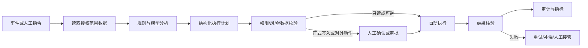

# 制造业数字员工产品规划

版本：2026-10-09 v0.5  
状态：场景规划与企业 AI 蓝图对齐；邮件、CRM Agent、舆情和行情已有部分正式实现，具体以功能规格和运行验收为准；其余场景仍按数据源与适配器就绪度推进  
关联原型：[`prototypes/digital-employee`](../../../prototypes/digital-employee/README.md)

## 0. 企业 AI 转型评审与当前版本说明

完整评审见[《7000 人科技企业 AI 转型与数字员工建设方案》](enterprise-ai-transformation-plan.md)。本文件保留行业场景地图；企业定位、投入选择、试点顺序与运营治理采用新蓝图建议。建议仍待业务评审，不自动修改已批准的运行规则。

- 员工普惠工具、业务内嵌助手、确定性自动化和受控 Agent 分工建设；数字员工是岗位容器，Skill 是工作方法。
- 项目先服务销售与运营闭环，不承诺承载全企业办公、研发与制造核心系统。
- 先评估现有邮件和商机能力的净提效，再从采购、质量、BI 中按数据就绪度选择一个扩展闭环。
- 公共能力复用身份、连接、证据、运行与审计；场景保留独立处理策略及完成标准，不统一所有任务状态机。
- 启用评分不能代替权限、接口、评测、接管等必要条件；这一原则是后续产品调整建议，当前阈值实现未改。
- 下文首期/原型范围描述历史阶段，不能解释为当前所有功能仍仅是模拟。已有实现也不等于完成企业级容量与生产验收。

### 岗位与案例深化（2026-10-09）

企业蓝图已补充 12 类岗位、8 个具体场景包及购买/集成/自研边界；详见[蓝图第 14 章](enterprise-ai-transformation-plan.md#14-岗位场景深化与行业案例v11-增量)及[行业案例证据笔记](../../research/role-ai-industry-cases-20261009.md)。证据区分企业披露、产品能力与 GitHub 示例；外部收益不作为本公司承诺，候选场景不等于已获开发授权。

## 1. 背景与目标

制造企业的日常工作分散在邮件、飞书、CRM、ERP、MES、WMS、QMS、EAM、文档和电子表格中。大量工作不是单纯“问答”，而是发现异常、收集上下文、生成处理建议、等待人员确认，再调用确定性系统完成动作。

本产品建设一组受权限和审计约束的数字员工，为业务人员提供统一任务入口。数字员工负责重复的信息收集、理解、整理和流程推进；业务责任人继续承担判断、授权和结果责任。

产品目标：

1. 减少跨系统查询、复制、汇总和催办时间。
2. 让缺料、延期、质量、库存和设备异常更早被发现。
3. 让对外沟通、正式单据和关键状态变更始终处于可控确认链路。
4. 每个结论能回到邮件、单据、批次、设备或知识文档等原始证据。
5. 形成可配置、可复用、可度量的数字员工运行平台。

## 2. 行业场景依据

Microsoft 的制造业场景库覆盖生产排程、班次计划、可视化作业指导、预测性维护、制造检查、工厂运营、供应商质量和生产计划等 Agent 场景；其制造业资料同时将生产、维护、质量和库存列为工厂运营的核心模块。SAP 的业务 AI 场景包含采购申请/订单、入库与运输文档、生产订单、排程结果解释和销售订单履约异常。UiPath 的制造业自动化场景覆盖供应商准入、采购订单、发票、库存、订单处理、质保索赔、现场服务与 ERP 同步。

本规划将这些公开场景作为外部参考，并结合 Forge CRM 现有销售、报价、订单、库存、审批和 Agent 能力形成项目级决策。参考资料不等同于本项目已具备相应系统数据和生产能力。

完整的一手资料摘录、事实与产品推演边界见[《制造业数字员工场景研究笔记》](../../research/manufacturing-digital-employee-scenarios.md)。

## 3. 产品定位与边界

### 3.1 产品定位

数字员工是“有岗位目标、工具权限、规则、记忆范围和人工责任人的任务执行单元”，不是一个可以无限操作系统的通用聊天机器人。

每个数字员工由六部分组成：

- 岗位目标：解决什么业务问题。
- 数据范围：允许读取哪些组织、法人、仓库、客户、供应商和设备数据。
- 工具集合：允许调用哪些查询、草稿、流程和执行接口。
- 行动策略：哪些动作自动完成，哪些动作需要确认或审批。
- 业务责任人：异常、失败和高风险动作由谁接管。
- 衡量指标：节省时间、处理及时率、建议采纳率和业务结果。

### 3.2 历史首期原型边界（保留阶段记录）

- 支持网页主入口和飞书辅助入口的规划；原型仅实现网页模拟。
- 支持读取、归纳、提取、生成草稿、形成待确认动作和模拟执行记录。
- 不允许模型直接发送邮件、修改正式单据、变更库存、改变生产计划或关闭异常。
- 不在原型中连接真实邮箱、飞书、ERP、MES、WMS、QMS、设备或模型服务。
- 预测性维护、视觉质检和高级排程依赖专用算法或现有系统结果；LLM 负责解释、协同和流程推进，不替代这些算法。

## 4. 制造业数字员工场景地图

| 领域 | 数字员工 | 常用任务 | 主要输入 | 受控输出 | 建议阶段 |
|---|---|---|---|---|---|
| 销售 | 销售邮件助手 | 识别询价、客户需求和承诺日期；关联客户/商机；起草回复与跟进计划 | 邮件、CRM、报价、订单 | 回复草稿、商机待办、询价摘要 | P0/P1 |
| 客服 | 客诉协同员 | 识别投诉、序列号/批次、影响范围；建立问题单；协调回复 | 邮件、工单、QMS、批次追溯 | 客诉草稿、问题单草稿、升级建议 | P1 |
| 采购 | 采购协同员 | 供应商报价归集比价、订单确认、交期跟催、异常升级 | 邮件、采购订单、供应商、库存 | 比价表、催办草稿、交期风险 | P0/P1 |
| 计划 | 计划齐套助手 | 识别缺料、产能和订单冲突；解释排程结果；给出调整方案 | 销售订单、BOM、库存、采购、产能 | 齐套清单、方案草稿、影响订单 | P1/P2 |
| 生产 | 生产运营助手 | 班次摘要、工单偏差、停线和产量异常整理；SOP 查询 | MES、工单、安灯、SOP | 交班摘要、异常任务、处置建议 | P1 |
| 质量 | 质量追溯助手 | 不良聚类、批次/序列号追溯、质量事件摘要、8D 初稿 | QMS、检验、批次、工艺、供应商 | 追溯报告、8D 草稿、隔离建议 | P1/P2 |
| 仓储 | 库存运营助手 | 收发异常、超储/呆滞、库龄、盘点差异、批次效期提醒 | WMS、库存、出入库流水 | 盘点任务草稿、移库建议、预警 | P1 |
| 设备 | 设备维护助手 | 告警归并、维修知识检索、工单摘要、备件检查 | EAM、IoT 告警、维修记录、备件 | 维修工单草稿、检查步骤、升级建议 | P2 |
| 财务 | 单据核对助手 | 发票/订单/收货三单匹配、运费核验、回款提醒 | 发票、订单、收货、物流、应收 | 差异清单、凭证草稿、提醒草稿 | P1/P2 |
| EHS | 安全与合规助手 | 隐患上报整理、法规/SOP 查询、事件复盘材料汇总 | 巡检、事件、培训、SOP | 整改任务草稿、复盘摘要、提醒 | P2 |
| 管理 | 经营日报助手 | 汇总销售、交付、生产、质量、库存和现金异常 | 业务指标、任务、事件 | 日报草稿、风险清单、会议材料 | P1 |

### 4.1 场景定义标准

后续不再只用“销售助手、生产助手”这类宽泛名称描述能力。每个场景必须具体到一次可验收的工作闭环，并包含以下内容：

| 要素 | 说明 |
|---|---|
| 场景任务 | 用动宾结构命名，例如“核对采购订单交期并生成催办草稿” |
| 触发条件 | 邮件到达、单据变化、定时巡检、阈值越界或人工指令 |
| 输入证据 | 明确到邮件、单据、批次、序列号、设备、行情或知识文档 |
| 处理步骤 | 查询、关联、计算、规则判断、模型归纳及工具调用的顺序 |
| 业务输出 | 明确是摘要、差异清单、草稿、待办、预警还是正式动作 |
| 控制点 | 人工确认、审批、职责分离、置信度阈值、失败补偿和接管人 |
| 衡量指标 | 耗时、准确率、及时率、一次采纳率，以及交付、质量或成本结果 |

数字员工是岗位容器；岗位下面可以启用多个具体场景。例如“采购协同员”可以同时承载供应商报价归一、订单确认、交期跟催和供应风险巡检，但每项任务分别配置权限、规则、指标和确认策略。

### 4.2 电子制造业核心场景清单

#### 市场、销售与订单

| 编号 | 具体场景 | 触发与处理 | 可交付结果 | 人工控制点 |
|---|---|---|---|---|
| ES-01 | 读取客户 RFQ 并建立询价任务 | 新邮件/附件到达后识别客户、料号、数量、目标价、交期、认证及附件版本；关联客户、商机和历史报价 | 结构化 RFQ、缺失项清单、询价任务、回复草稿 | 客户身份不确定、承诺价格/交期、发送回复时确认 |
| ES-02 | 汇总技术评审与报价成本 | 汇集 BOM、工艺、治具/NRE、测试、包装、物流、材料行情、汇率和目标毛利；标记未报价物料 | 成本分解、风险假设、报价建议区间、报价单草稿 | 技术可行性、成本口径、毛利例外和正式报价审批 |
| ES-03 | 分析销售订单变更影响 | 客户修改数量、交期、版本或交付地时，关联在制工单、采购、库存、委外和物流 | 受影响清单、增量成本、可承诺日期、变更方案草稿 | 停工、改料、加急采购、价格和交期承诺需审批 |
| ES-04 | 监控订单承诺与交付风险 | 定时比较销售承诺、齐套、产能、检验和物流节点，按风险排序 | 订单风险雷达、责任人待办、客户沟通草稿 | 对外承诺、拆单/合单、交付优先级调整需确认 |
| ES-05 | 汇总预测与真实需求偏差 | 对比客户预测、历史拉货、销售订单、促销和取消记录 | 预测偏差、异常客户/SKU、备货建议 | 预测结果不能直接生成采购或生产计划 |

#### 研发、工程与产品数据

| 编号 | 具体场景 | 触发与处理 | 可交付结果 | 人工控制点 |
|---|---|---|---|---|
| EE-01 | 评估 BOM/ECN 变更影响 | ECO/ECN 提交后穿透在库、在途、工单、委外、替代料、客户订单和旧版库存 | 影响范围、切换批次、呆滞风险、处置任务草稿 | BOM 发布、旧料报废、客户偏离许可必须审批 |
| EE-02 | 核对元器件规格与合规资料 | 读取规格书、承认书、RoHS/REACH、寿命状态和供应商变更通知，核对物料主数据 | 缺失/过期资料、参数差异、受影响产品和供应商待办 | 合规结论和替代料批准由工程/质量负责人确认 |
| EE-03 | 生成试产准备检查表 | 新产品/新版本试产前检查 BOM、工艺路线、程序、钢网、治具、检验规范、首件标准和物料齐套 | 试产门禁清单、未完成责任项、会议材料 | 不得代替工程签核和首件放行 |
| EE-04 | 汇总验证测试与问题闭环 | 聚合测试记录、失败现象、版本、责任人和修复状态，识别重复问题 | 测试摘要、缺陷聚类、未闭环问题、发布风险 | 版本放行仍由设计/质量角色审批 |

#### 采购与供应商协同

| 编号 | 具体场景 | 触发与处理 | 可交付结果 | 人工控制点 |
|---|---|---|---|---|
| EP-01 | 归一供应商报价并辅助比价 | 读取不同格式报价单，统一币种、税率、MOQ、MPQ、阶梯价、交期、账期和有效期 | 可比价表、缺失项、总拥有成本、建议候选 | 定标、议价承诺和供应商选择必须人工决策 |
| EP-02 | 核对采购订单确认与交期 | 采购订单发送后监控供应商回签、数量、价格和交期差异；结合需求日判断风险 | 未确认清单、差异项、催办邮件草稿、升级任务 | 外发邮件和采购订单变更需确认 |
| EP-03 | 识别多级供应与替代风险 | 聚合交期表现、质量、产能、单一来源、停产/EOL、地缘与公开风险信号 | 供应商风险卡、受影响料号/订单、备选方案 | 外部舆情仅作为线索；冻结、替换供应商需审批 |
| EP-04 | 监控材料行情与汇率敞口 | 定时读取有授权的数据源，结合铜、铝、锡、金、原油等行情、人民币汇率、采购合同和未交订单计算影响 | 价格波动日报、采购敞口、成本敏感性、询价提醒 | 不提供交易指令；锁价、套保、调价由财务/采购审批 |
| EP-05 | 检查供应商来料与改善进度 | 汇总 IQC、不合格、退货、SCAR/8D、批次和改善期限 | 供应商质量周报、逾期改善、复发问题、升级建议 | 让步接收、退货和供应商处罚需确认 |

#### 计划、生产与现场运营

| 编号 | 具体场景 | 触发与处理 | 可交付结果 | 人工控制点 |
|---|---|---|---|---|
| EM-01 | 计算工单齐套与缺料影响 | 比较 BOM 需求、可用库存、批次/替代规则、在途、检验冻结和领料记录 | 缺料清单、最早齐套日、受影响工单、催料任务 | 替代料、挪料、超领和计划变更需审批 |
| EM-02 | 解释排程冲突并比较方案 | 接收 APS/规则算法结果，说明瓶颈设备、换线、物料和人员约束；模拟方案差异 | 冲突原因、方案对比、订单影响、建议顺序 | LLM 只解释；正式排程由专用算法计算并由计划员发布 |
| EM-03 | 核对 SMT/组装换线准备 | 换线前核对程序版本、钢网、锡膏、飞达、料站表、首件、治具、作业指导和人员资质 | 换线清单、缺项、责任人提醒 | 程序下发、设备参数和首件放行不可自动完成 |
| EM-04 | 生成班次交接摘要 | 班末汇总计划/实际、停线、良率、待料、返修、设备告警和未闭环安灯 | 交班摘要、下一班重点、责任项 | 班组长确认后发布；原始记录不可被摘要覆盖 |
| EM-05 | 协同生产异常闭环 | 安灯、停线或指标越界后聚合工单、设备、物料、质量和历史相似事件 | 异常时间线、排查清单、通知草稿、复盘材料 | 停复线、参数修改、报废和让步放行必须授权 |
| EM-06 | 监控工艺参数与良率关联 | 接收 SPC、视觉、小模型或设备算法的异常结果，关联批次、机台、程序和材料 | 异常批次、趋势解释、抽检/隔离建议 | LLM 不直接判断合格或修改设备参数 |

#### 质量、追溯与售后

| 编号 | 具体场景 | 触发与处理 | 可交付结果 | 人工控制点 |
|---|---|---|---|---|
| EQ-01 | 聚类制程不良并生成质量早报 | 汇总 AOI/SPI/ICT/FCT、抽检和返修代码，按产品、线体、机台、班次、物料批次做 Pareto | 良率日报、异常聚类、关联线索、复核任务 | 缺陷归因是建议，需质量工程师确认 |
| EQ-02 | 追溯序列号与批次影响范围 | 输入序列号/客户批次后，反查成品、工单、关键物料、供应商批次、设备、检验和出货 | 正反向追溯图、在库/在途/已交付数量、隔离范围建议 | 冻结、召回、通知客户属于高风险审批动作 |
| EQ-03 | 协同客诉、RMA 与 8D | 识别客户现象、序列号、失效模式和附件；关联相似缺陷、返修和追溯结果 | 客诉摘要、RMA 草稿、8D 初稿、客户回复草稿 | 根因、责任、赔付和客户正式回复需负责人确认 |
| EQ-04 | 检查质量文件与审核准备度 | 对照 IATF/ISO、控制计划、检验标准、校准、培训和变更记录检查缺失项 | 审核资料索引、证据缺口、整改待办 | 不自动给出认证结论；法规解释需专业复核 |

#### 仓储、物流与成本

| 编号 | 具体场景 | 触发与处理 | 可交付结果 | 人工控制点 |
|---|---|---|---|---|
| EW-01 | 发现收发与账实异常 | 比较 ASN、收货、IQC、上架、领退补料、出货和库存事务流水 | 差异链路、疑似原因、复盘清单 | 库存调整、过账、反过账必须审批并保持流水 |
| EW-02 | 规划循环盘点 | 根据 ABC、价值、差异频率、批次/序列要求和库龄选择盘点对象 | 盘点建议、任务草稿、差异复核队列 | 正式盘点和库存调整由仓库人员执行 |
| EW-03 | 识别呆滞、超储和效期风险 | 结合需求、BOM 使用关系、最后移动、在制、替代和未来订单分析 | 呆滞原因、消耗路径、调拨/退供/处置建议 | 报废、降价、退供和跨法人调拨需审批 |
| EW-04 | 追踪出货与物流异常 | 关联销售出库、箱号、承运商轨迹、报关和客户预约，识别停滞/延误 | 异常件清单、预计影响、承运商/客户沟通草稿 | 改址、取消、赔付和对外回复需确认 |
| EF-01 | 执行订单—收货—发票核对 | 读取订单、收货、发票、税率、运费和价差规则，定位数量/价格/税差 | 三单匹配结果、差异责任队列、付款建议 | 付款、凭证和供应商扣款必须由财务审批 |
| EF-02 | 分析订单/产品毛利变化 | 将标准成本、采购价、损耗、汇率、物流、返工和售后费用归集到订单/产品 | 毛利桥、异常订单、成本驱动和调价建议 | 财务口径确认；不可自动更改报价或售价 |

### 4.3 跨行业但可复用的员工提效场景

| 编号 | 数字员工场景 | 具体可做事项 | 边界与控制 |
|---|---|---|---|
| EC-01 | 多平台电商订单运营 | 从已授权的天猫、京东、抖音、拼多多、独立站等接口汇总订单、退款、库存和活动数据；形成待发货/异常订单队列；将确认后的订单同步 ERP | 优先使用官方 API；改价、取消、退款、活动报名和库存发布需确认 |
| EC-02 | 售前售后客服协同 | 识别意图，查询商品、订单和物流，推荐知识答案；创建售后工单、退款/换货草稿并转人工 | 可自动回答低风险标准问题；赔付、退款、投诉升级和承诺必须确认 |
| EC-03 | 评论与用户之声分析 | 汇总自有店铺或授权渠道评论，执行多语言翻译、情感/主题聚类，提取产品、包装、物流和服务问题 | 不绕过平台限制抓取数据；公开回复先生成草稿，辱骂/安全/监管问题转人工 |
| EC-04 | 物流轨迹与履约监控 | 聚合承运商轨迹、超时、拒收、破损和签收异常；关联订单价值和客户等级排序 | 修改物流、索赔、补发和客户通知需确认 |
| EC-05 | 店铺经营与投放助手 | 汇总 GMV、毛利、平台费、退货、广告消耗、转化和库存，识别亏损 SKU 与异常波动 | 预算调整、投放启停、价格和促销必须审批；禁止只看 GMV 忽略净利润 |
| MR-01 | 品牌舆情与风险雷达 | 对已授权新闻、社媒、客服和评论源进行实体归一、情绪/主题/传播趋势分析，识别质量、安全、劳资和供应链风险 | 只把外部内容作为线索；公开回应、删除请求和法律定性由品牌/法务处理 |
| MR-02 | 竞品与市场情报简报 | 监控公开新品、价格、渠道、招聘、专利、认证和经营事件，生成变化摘要和来源链接 | 尊重站点条款与版权；不得把推断写成事实或获取非公开数据 |
| FR-01 | 客户/供应商信用风险巡检 | 关联内部逾期、退货、质量和履约表现，以及有授权的工商、司法、制裁和舆情信号 | 自动生成风险线索和复核任务；冻结交易、降额和准入否决需审批 |
| MK-01 | 大宗商品与汇率监控 | 读取官方或商业授权行情，维护铜、铝、锡、金、原油及主要结算币种看板；计算采购、报价和订单敞口 | 明确现货/期货、币种、单位、时区与延迟；不生成自动交易或套保指令 |
| OF-01 | 合同与制度审阅助手 | 提取合同主体、金额、账期、质保、知识产权和违约条款，对照标准条款提示差异 | 只给差异和来源，不替代法务意见；签署和对外发送需审批 |
| HR-01 | 员工服务与排班助手 | 回答制度、假勤、薪酬口径；辅助排班、考勤异常解释、培训到期和资质提醒 | 薪酬、健康、绩效等敏感数据按最小权限；处分和人事决定不得自动化 |
| KM-01 | 企业知识与会议行动助手 | 搜索受权知识库，形成会议纪要、决策记录、责任项并跟踪到期 | 机密资料按原权限继承；会议推断需参会者确认 |

### 4.4 公开案例带来的产品启示

以下为公开资料中可核验的能力事实；右侧“产品启示”是本项目的设计推演，不表示相关企业采用了本方案。

| 公开事实 | 对本项目的启示 |
|---|---|
| 华为公开的长安汽车案例展示了 IT/OT 数据统一接入、生产全过程数据融合、智能排产和全息质量追踪 | 数字员工应建立在可追溯的数据对象和确定性算法之上，负责解释、协同和闭环，而不是绕过 MES/APS/QMS 自行决策 |
| 华为工业数字化资料列举美的 5G 全连接工厂及 5G+AI 质检；腾讯公开材料展示 AI 质检和云端制造协同 | 视觉/小模型应输出结构化检测结果，数字员工再负责关联批次、触发复核和生成处置任务 |
| 用友公开的制造智能体覆盖生产分析、质量分析、资产维修、资产健康诊断、库存健康、采购分析与 HR 服务 | 岗位型入口可以复用，但实施和验收应进一步拆成本文的具体任务场景 |
| 金蝶电子/半导体方案覆盖需求预测、排程、工程变更、追溯、成本、供应链和业财协同 | 电子制造原型应突出 BOM/ECN、元器件批次、序列号、良率和订单毛利，而不是只展示通用办公助手 |
| 腾讯企点和腾讯云客服覆盖全渠道咨询、商品/订单查询、工单、质检与情绪识别；火山引擎开发者资料公开了抖音电商团队的售后客服 Agent 模板 | 电商助手应把订单、物流、售后和评论统一为任务，不应只做聊天回复 |
| 阿里云 NLP/数据分析资料列出情感分析、电商评价、舆情分析、客服质检和多语言评论处理 | 评论与舆情场景需要“数据许可—分类聚类—风险分级—回复草稿—人工发布”的完整控制链 |
| 中国人民银行持续发布人民币汇率中间价，上期所提供铜、铝、锌、镍、锡等官方行情与库存查询 | 行情助手应保存来源、时间、单位和授权口径，再结合企业敞口计算影响；行情本身不能直接触发交易 |

### 4.5 建议形成的数字员工岗位与具体职责

| 数字员工岗位 | 首批启用的具体场景 | 后续扩展 |
|---|---|---|
| 客户需求与报价专员 | ES-01 RFQ 解析、ES-02 报价成本汇总 | ES-03 订单变更、ES-05 需求偏差 |
| 订单交付协调员 | ES-04 交付风险、EM-01 齐套分析 | EW-04 物流异常、客户沟通 |
| 电子物料采购专员 | EP-01 报价归一、EP-02 交期确认 | EP-03 供应风险、EP-04 行情敞口 |
| 工程变更协调员 | EE-01 BOM/ECN 影响、EE-03 试产准备 | EE-02 合规资料、EE-04 验证闭环 |
| 生产运营专员 | EM-03 换线准备、EM-04 交班摘要 | EM-02 排程解释、EM-05 异常闭环 |
| 质量追溯专员 | EQ-01 良率早报、EQ-02 批次追溯 | EQ-03 RMA/8D、EQ-04 审核准备 |
| 库存与物流专员 | EW-01 事务差异、EW-03 呆滞风险 | EW-02 循环盘点、EW-04 履约异常 |
| 设备健康专员 | 告警归并、维修知识和工单草稿 | 预测结果解释、保养周期优化 |
| 财务核对专员 | EF-01 三单匹配、EF-02 毛利变化 | 回款、费用、预算和现金风险 |
| 电商客户运营专员 | EC-01 订单汇总、EC-02 客服、EC-03 评论 | EC-04 物流、EC-05 店铺经营 |
| 品牌与外部风险专员 | MR-01 舆情、FR-01 信用风险 | MR-02 竞品、合规/制裁监控 |
| 市场价格风险专员 | MK-01 材料行情和汇率日报 | 报价/采购敞口情景分析 |

### 4.6 下一版原型建议范围（待确认）

下一版原型建议保留现有统一工作台，并把岗位卡片下钻为具体场景。首屏优先展示十二项高频、可解释、容易形成演示闭环的任务：

1. 客户 RFQ 自动解析与缺失项检查。
2. BOM、材料行情和汇率驱动的报价成本汇总。
3. 采购订单未确认与交期风险催办。
4. 工单缺料与最早齐套日分析。
5. SMT 换线准备门禁检查。
6. AOI/SPI/测试不良聚类与良率早报。
7. 序列号/批次正反向质量追溯。
8. 客诉、RMA 与 8D 协同。
9. 呆滞料、超储和效期风险处置建议。
10. 电商订单、售后、评论和物流异常工作台。
11. 品牌舆情与供应商外部风险雷达。
12. 铜/铝/锡等材料行情与主要币种敞口日报。

每个演示任务使用相同详情结构：触发事件、原始证据、关联业务对象、分析步骤、业务结论、拟执行动作、风险等级、责任人、确认记录和执行核验。这样能在增加场景数量的同时保持统一交互，不把原型做成互不相关的仪表盘集合。

## 5. 场景优先级

采用“业务频率 × 数据可得性 × 规则确定性 × 风险可控性 × 可量化收益”评分。

### P0：信息型数字员工

- 销售邮件摘要与回复草稿。
- 采购订单确认和交期跟催草稿。
- 跨系统搜索、邮件/单据关联、日报摘要。
- 所有结果保留来源证据，不产生正式业务写入。

### P1：协同型数字员工

- 缺料、订单延期、库存和质量异常监控。
- 创建待办、流程草稿、台账暂存和飞书个人提醒。
- 质量追溯、客诉协同、生产交班与经营日报。
- 经人工确认后调用已有工作流或业务接口。

### P2：受控执行型数字员工

- 确认后发送邮件/消息、建立正式单据、发起审批。
- 根据审批结果执行状态回写、调度或库存相关动作。
- 设备预警协同、排程方案比较和财务三单匹配。
- 需要完整幂等、补偿、并发和异常接管机制。

### P3：优化型数字员工

- 根据采纳率和人工修改提出规则调整建议。
- 多数字员工围绕订单交付、质量事件等案例协同。
- 规则变更仍由责任人批准，不允许自行扩大权限或启用新工具。

## 6. 产品信息架构

### 6.1 数字员工工作台

- 今日指标：待处理、待确认、高风险、执行成功率。
- 我的任务：按责任人、业务域、风险和截止时间统一排序。
- 运营态势：交付、供应、质量、库存和设备异常摘要。
- 运行中的数字员工：状态、最近执行、成功率和需关注事项。

### 6.2 任务中心

统一管理“发现—分析—计划—确认—执行—核验”全过程。任务必须展示业务对象、来源、责任人、截止时间、风险等级、当前步骤和下一动作。

### 6.3 数字员工管理

维护岗位目标、负责人、业务范围、工具、规则、主动程度、工作时间、异常接管和指标。启停数字员工属于管理动作，需要权限和审计。

### 6.4 场景中心

提供制造业场景目录和成熟度：只读建议、草稿协同、受控执行。场景启用前必须完成数据、接口、权限、风险和验收检查。

### 6.5 待确认中心

集中展示邮件发送、外部消息、正式台账、单据、状态变更和高风险批量动作。确认对象是固定版本的执行计划；计划内容发生变化后原确认自动失效。

### 6.6 规则与策略

规则由确定性条件、AI 判断、风险等级、动作和生效范围组成。AI 判断必须输出理由、置信度和证据；低置信度只生成建议。

### 6.7 集成与审计

展示邮箱、飞书、CRM、ERP、MES、WMS、QMS、EAM、文档库和 IoT 的授权与同步状态。审计记录任务输入、模型/规则版本、工具调用、确认人、执行结果和补偿结果。

## 7. 共性业务流程



## 8. 权限与风险分级

| 等级 | 动作示例 | 默认处理 |
|---|---|---|
| L0 读取 | 搜索、摘要、解释、关联证据 | 授权范围内自动执行 |
| L1 可逆 | 标签、普通归档、生成内部提醒 | 自动执行并记录；可配置确认 |
| L2 暂存 | 邮件草稿、台账草稿、待办草稿、单据草稿 | 自动生成，人员审阅 |
| L3 外部/正式 | 发邮件、发群消息、提交单据、变更状态 | 必须人工确认或审批 |
| L4 高风险 | 群发、付款、库存过账、生产排程发布、批量关闭事件 | 二次确认或工作流审批，支持职责分离 |

有效权限始终为：用户数据权限 ∩ 数字员工业务范围 ∩ 工具授权 ∩ 当前动作策略。模型输出不能扩大任何一层权限。

## 9. 技术与数据架构

```text
入口：网页工作台 / 飞书 IM / 定时与业务事件
  ↓
任务编排：任务状态机 / 计划版本 / 重试与补偿 / 人工接管
  ↓
智能能力：意图、摘要、抽取、分类、RAG、专用预测/视觉算法结果解释
  ↓
策略控制：RBAC、数据范围、风险分级、确认/审批、DLP、Schema 校验
  ↓
工具连接：Mail / IM / CRM / ERP / MES / WMS / QMS / EAM / 文档 / IoT
  ↓
底座：密钥管理、审计、可观测性、模型与规则版本、评测和成本
```

核心概念实体包括 `DigitalEmployee`、`ScenarioDefinition`、`AgentTask`、`ActionPlan`、`ActionApproval`、`ExecutionRecord`、`EvidenceReference`、`ConnectorAccount`、`AutomationRule` 和 `AuditEvent`。正式数据设计需另行进入 Architecture Gate，并遵循本项目数据库规范。

## 10. 关键安全设计

- 邮件、附件、聊天和外部文档一律视为不可信业务内容，不能成为系统指令。
- 连接器令牌存入密钥系统，模型和业务表不接触明文密钥。
- 对外收件人、外部域名、敏感附件、付款与库存动作执行前再次校验。
- 每次确认绑定执行计划摘要与版本；修改后重新确认。
- 发送、过账和单据创建使用幂等键；超时后先核验状态再重试。
- 原始证据、模型输出、人工修改和最终执行结果分别保存，不能互相覆盖。
- 共享邮箱和共享数字员工记录实际确认人、执行人和接管人。

## 11. 产品指标

### 效率

- 每类任务平均人工处理时间下降比例。
- 数字员工成功生成可用草稿的比例。
- 跨系统信息收集耗时和异常响应时长。

### 质量

- 提取准确率、业务规则通过率、草稿一次采纳率。
- 错误执行、重复执行、越权尝试和人工撤销数量。
- 建议的证据覆盖率和低置信度正确降级率。

### 业务

- 订单按期交付率、供应商按期回复率。
- 缺料提前发现时间、质量事件关闭周期。
- 库存异常处理时长、设备停机时长。

### 运营

- 日活跃用户、活跃数字员工、任务吞吐量。
- 确认等待时长、失败率、人工接管率和单位任务成本。

## 12. 原场景实施路线（企业推进顺序见新蓝图）

1. **准备阶段**：选定两个 P0 场景，定义数据范围、责任人、黄金样例和不可执行边界。
2. **MVP**：实现统一工作台、任务中心、证据引用、邮件/采购草稿和审计。
3. **协同阶段**：接入飞书提醒、工作流、异常监控和台账暂存。
4. **受控执行**：按动作逐个开放确认后执行，补齐幂等、补偿和职责分离。
5. **规模化**：建立场景模板、评测集、运行指标、成本管理和变更治理。

建议首批落地场景：

1. 销售询价邮件 → 客户/商机关联 → 回复与报价准备草稿。
2. 采购订单 → 供应商确认邮件 → 交期异常识别 → 跟催草稿与提醒。
3. 质量投诉 → 批次追溯资料汇总 → 问题单与客户回复草稿。

这三类场景频率高、过程可观察、人工确认自然，且能验证邮件、业务系统、证据、任务和审批五类共性能力。

## 13. 历史原型范围与验收（不代表当前正式实现状态）

原型验证以下问题：制造业用户能否从一个工作台看清数字员工正在处理什么、为什么产生建议、下一步由谁确认，以及各岗位数字员工的职责边界是否易于理解。

原型包含工作台、任务中心、数字员工、场景中心、待确认、规则策略、集成和审计页面；提供任务详情、建议生成、确认/驳回、启停员工与筛选交互。所有数据仅在浏览器内存中变化，刷新即恢复。

验收标准：

- 从主框架顶部机器人图标进入内容区，形成独立工作区页签。
- 首屏明确展示待处理、待确认、高风险、运行员工和业务态势。
- 每个任务能查看来源证据、分析、执行计划、风险和责任人。
- 正式或对外动作必须进入确认；驳回后不能继续执行。
- 可查看九类制造业数字员工及其数据、工具、动作和指标边界。
- 原型服务不可用时在内容区显示明确启动指引，不影响正式业务页面。

## 14. 外部参考

### 制造与电子行业

- [Microsoft：Using Copilot in Manufacturing](https://adoption.microsoft.com/en-us/scenario-library/manufacturing/)
- [Microsoft：AI in manufacturing](https://www.microsoft.com/en-us/microsoft-copilot/copilot-101/ai-in-manufacturing/)
- [Microsoft Learn：Trace and solve quality issues with Copilot](https://learn.microsoft.com/en-us/dynamics365/release-plan/2024wave2/finance-supply-chain/dynamics365-supply-chain-management/trace-solve-quality-issues-copilot)
- [Microsoft Cloud：Optimizing factory operations](https://www.microsoft.com/en-us/microsoft-cloud/blog/manufacturing-and-mobility/2024/04/17/optimizing-factory-operations-with-microsoft-cloud-for-manufacturing/)
- [SAP Help：Supply Chain Joule capabilities](https://help.sap.com/docs/joule/capabilities-guide/supply-chain?ai=true&locale=en-US)
- [UiPath：Manufacturing automation solutions](https://www.uipath.com/solutions/industry/manufacturing-automation)
- [华为：长安汽车数字底座、智能排产与全息质量案例](https://e.huawei.com/cn/case-studies/industries/manufacturing/202412-changan-yubei-new-factory)
- [华为：工业数字化 2030（含美的 5G+AI 质检案例）](https://www-file.huawei.com/admin/asset/v1/pro/view/7ffffa5fa5e7469692d4704b92ef17d7.pdf)
- [美的：AI 与数字孪生贯通选型报价、设计、制造和售后](https://mbt.midea.com/global/news/ai-zero-carbon--the-world-s-first-fully-ai-powered-chiller-light.mobilemobile)
- [美的：智能体工厂中的计划、首检、质量、工艺、TPM 与物流协同](https://www.midea.com.cn/zh/about-midea/news/_16)
- [腾讯：产业数字化与制造 AI 案例资料](https://static.www.tencent.com/uploads/2022/04/16/56e61654efa69f7503f997520a8f2766.pdf)
- [用友：生产、质量与设备管理智能体](https://www.yonyou.com/news/4613)
- [用友：库存健康、采购分析、质量分析与资产健康](https://www.yonyou.com/subject/Localization/news/4628)
- [金蝶：电子半导体行业解决方案](https://www.kingdee.com/solutions/electronics.html)
- [金蝶：芯源微研产供销协同案例](https://www.kingdee.com/success-stories/1694193128275308545.html)
- [金蝶：智慧工厂云](https://www.kingdee.com/products/galaxy_smart_factory.html)

### 客服、电商、评论和舆情

- [腾讯云：企点客服产品能力](https://cloud.tencent.com/document/product/1177/40501)
- [腾讯云：电商解决方案](https://cloud.tencent.com/act/pro/e-business)
- [腾讯云：客服大模型机器人](https://cloud.tencent.com/product/cslr)
- [阿里云：自然语言处理及电商评价、舆情分析场景](https://help.aliyun.com/zh/document_detail/60866.html)
- [阿里云：网络评论情感分析实践](https://help.aliyun.com/zh/maxcompute/sentiment-analysis-of-web-comments-using-maxcompute-public-model)
- [阿里云：智能对话分析应用场景](https://help.aliyun.com/zh/sca/product-overview/scenarios)
- [火山引擎开发者社区：抖音电商售后客服 Agent 实践](https://developer.volcengine.com/articles/7486690029038354473)

### 行情和汇率来源示例

- [中国人民银行：人民币汇率中间价公告](https://www.pbc.gov.cn/zhengcehuobisi/125207/125217/125925/17105-2.html)
- [上海期货交易所：日周行情数据](https://www.shfe.com.cn/reports/tradedata/dailyandweeklydata/)
- [上海期货交易所：有色金属数据系统开放通知](https://www.shfe.com.cn/publicnotice/notice/202503/t20250327_824890.html)

## 15. 提炼后的数字员工场景与开发衔接（2026-10-09）

行业研究已收敛为可接续当前产品的场景；本节为产品增量建议，当前代码与已批准策略保持原状。

| 场景 | 数字员工职责 | Agent 协同 | 建设状态 |
|---|---|---|---|
| 邮件/售后闭环 | 收件、队列、分派、回复/等待/结论、结果核验 | 提取诉求及依据、生成回复草稿 | 首批增强，先核查已实现部分 |
| 客户会议到商机跟进 | 确认任务后的责任/期限/执行反馈 | 会议文字输入、事实与推断分离、多行动草稿 | 首批 Agent 增强 |
| 产品 FAQ/SOP 知识 | 维护人、版本、有效期、适用范围 | 受授权检索及引用，辅助邮件/商机 | 小范围近期建设 |
| 采购订单回签 | 行级差异队列、催办、等待与确认 | 回签提取和差异说明 | 接口就绪后 SCN-PO 增强 |
| 客诉质量事件 | 证据/责任项/工程师确认 | 时间线、缺失清单、8D 草稿 | 数据就绪后 SCN-RMA 增强 |
| 销售/库存经营分析 | 异常责任事项与结果记录 | 固定指标查询、可复算解释与行动草稿 | 口径就绪后择一主题 |

分派、监控、预警与完成策略仍由场景分别定义。邮件发送结果不等于客户问题解决；采购回签不等于交货；8D 草稿不等于根因确认。公共总览只聚合来源、责任、期限及结果，不强制共用处理状态。

配套补充场景准备状态、关键启用条件、运行证据、接管及价值测量；现有启用评分不能单独取代关键条件。数字员工不新增任意电脑操作权限，舆情继续手工触发，暂缓菜单保持不变。

开发入口：[场景增强 Plan](../../../.specify/specs/ai-scenario-enhancement/plan.md)、[任务清单](../../../.specify/specs/ai-scenario-enhancement/tasks.md)。近期顺序为差距核查→邮件→商机会议→小范围知识；采购、质量、经营分析按准备度择一，不承诺并发全部开发。

## 2026-10-09 邮件与知识辅助首批切片

邮件任务结果详情和连接隔离已补齐；知识辅助草稿复用个人Agent，只生成供审阅的文字。商机会议行动及私有知识版本同批交付，见[阶段记录](../../../.specify/specs/ai-scenario-enhancement/review.md)。企业基线、真实效果及条件场景仍保持待验收，不据代码完成自动扩展运行范围。


## 2026-10-09 后续页面演示切片交付（当前态覆盖）

用户明确要求不等待外部接口。采购回签、客诉质量/8D、经营分析已先实现功能页面，每个15条独立DEMO记录，接口作为可保存配置项；支持人工编辑、规则草稿、处理结论与关闭/重开。真实ERP/QMS/BI适配及业务责任人、指标口径验收仍待后续任务，不宣称真实业务已自动化。

入口与边界见 [三场景使用说明](business-scenes-guide.md)。已完成页面不再列为“接口就绪后才开发”；“待接口”仅指真实取数、凭据和来源映射联调。本轮交付后停止，不自动扩大场景范围。
