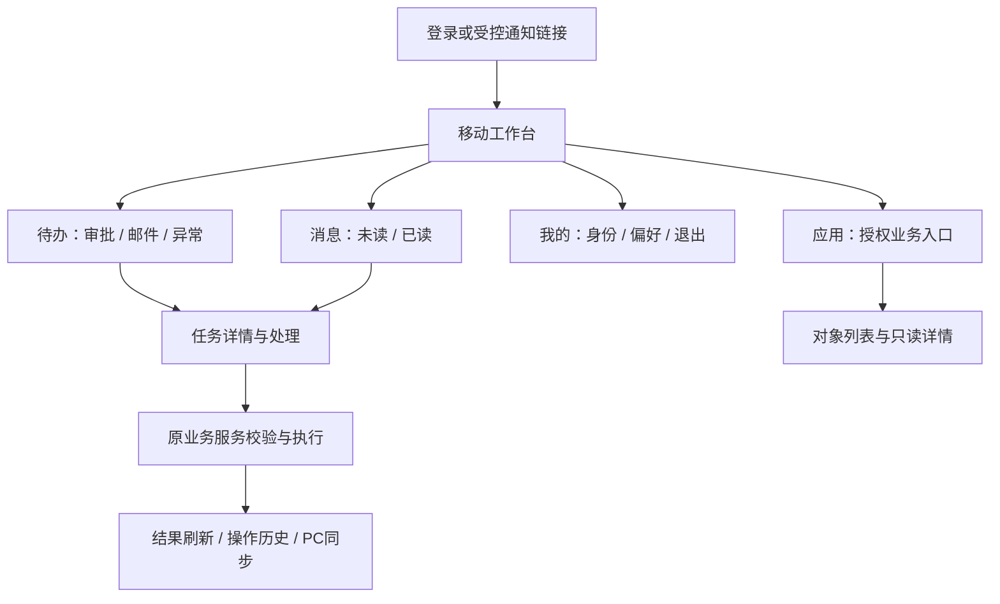

# Forge CRM移动工作台设计方案

版本v0.1；2026-10-11；状态：待评审。本轮交付方案与详细需求，不开发。需求依据见[原始输入](../../../.specify/sources/20261011-mobile-workspace/source.md)，功能细则见[详细需求规范](../../../.specify/requirements/mobile-workspace/requirement.md)。

## 1. 定位与设计依据

移动工作台服务于“有空就处理、现场就查询”：审批人查看依据并决策，邮件处理人阅读/回复并完成任务，业务人员查询记录和异常。与PC共享一套业务状态、权限、数据和审计，竖屏交互独立设计。

销售易开发者介绍有个性化视图、任务运营与销售业务能力，官方销售云页面有移动演示入口；本项目借鉴角色导向、任务与业务对象联动、移动审批方向。[App开发者介绍](https://apps.apple.com/cn/app/%E9%94%80%E5%94%AE%E6%98%93crm/id654720925)、[销售云](https://www.xiaoshouyi.com/sfaold)

“底部四入口、卡片、单列详情、底部操作栏”是本项目设计建议。未登录销售易当前版本，不宣称像素复刻。完整事实与未知项见[参考记录](sales-easy-reference.md)。

## 2. 角色与范围

|角色|优先场景|权限边界|
|---|---|---|
|审批人/部门负责人|待我审批、关键金额/风险、单据与附件、审批意见|仅自身可处理节点和已授权记录；负责人身份不自动拥有全部门数据|
|邮件处理人|我的邮件任务、回复、暂挂、关注、备注、完成|邮箱授权、任务责任和场景动作权限共同生效|
|场景主管/分派人|队列、超时、分派、进度查询|团队/队列范围按现有策略，不能借移动汇总扩大数据范围|
|销售/采购业务人员|单据查询、进度、相关对象|一期只读，不开放大明细编辑、移动过账/冲销|
|系统管理员|查看个人工作和必要任务|系统配置留PC；管理权限不默认意味着可读取所有邮箱正文|

|阶段|内容|明确排除|
|---|---|---|
|P0一期闭环|移动框架/登录、工作台、分类待办、工作流审批、邮件任务处理与确认发送、消息、六类单据只读、我的|流程/规则配置、大明细录入、批量审批/导出、库存过账/冲销、永久删除邮件、全局暂停数字员工|
|P1扩展|客户/商机查询和轻量跟进、供应商查询、库存只读、舆情处理、现有可选转交/分派能力、PWA桌面入口|未接入的数据接口不得显示模拟信息为真实结果|
|P2后置|扫码、拍照上传、飞书/企微消息及免登适配、个人移动卡片布局|各项需单独确定授权、设备能力及接口，不默认进入一期|

审批的基础同意/驳回为P0；退回/转交在任务确实支持且权限校验完成时作为P1。邮件分派在原队列/人员可选择与授权已验证后为P1，一期不因此阻塞个人任务闭环。

## 3. 信息架构

底部为“工作台、待办、应用、我的”，所有用户位置一致；无权限的模块入口不展示，Tab保留并呈现适当空状态。消息入口在顶部；数字员工按“邮件、舆情”等场景展示，不加入含义模糊的万能Agent入口。

首页显示待我审批、我的邮件待处理、我的超时任务、重要预警，以及最近工作和授权快捷入口。数字是服务端按当前作用域返回的实际结果；失败显示未加载，不将错误显示为0。

## 4. 页面设计与竖屏规范建议

以下为移动专用建议，未修改全局样式索引。PC的12px字号、32px按钮和宽表格不能直接缩小套用；移动例外在开发前需纳入明确样式约定。

|元素|建议规范|
|---|---|
|布局|竖屏单列；左右16px间距，分组间16px；390px为设计基准，验收360/390/430px宽度，320px保持可用|
|字体|中文系统字体，正文/输入16px，摘要14px，标题18px；支持系统文字放大，金额与单位同时显示|
|色彩|复用现有主色/状态色/图标；白底、浅灰分隔，不仅靠颜色区分状态|
|触控|可点击热区至少44×44px，常用按钮44px高；危险动作不与主动作紧贴|
|导航|详情统一左返回箭头；无PC多工作区Tab、右键菜单；返回恢复查询、分页位置和滚动|
|列表|顶部搜索、筛选/当前视图入口、卡片记录；名称/单号点击进入，不放独立查看图标|
|记录卡|最多1个标题、1个状态、3—5个关键字段、必要时间；摘要两行省略，详情显示完整；常用动作至多2个，其他在更多菜单|
|筛选|搜索显式提交；抽屉单列字段，底部重置/查询；查询后回第一页，显示条件数量|
|详情|标题及“字段名：字段值”只读摘要；基本信息分组单列，明细逐行查看，不用嵌套多层边框|
|内容切换|使用客户详情的下划线选中风格；仅适用于任务分类等，单据保持主表+明细，不另造单据Tab|
|底部动作|详情固定主要动作；更多为次要动作；计入安全区，正文底部预留高度，软键盘弹出不遮输入|
|取消|弹层取消/关闭直接退出，不弹未保存确认；需要保存回复草稿必须显式点保存|
|空/加载/失败|区分无记录、无权限、服务失败、发送结果未知；可刷新/重试，不闪烁显示假成功|

### 典型审批详情

顶部返回+审批主题；摘要显示单号、申请人、金额和单据状态；下面依次为关键业务字段、明细、附件、当前节点、审批记录与完整流程入口。底部“驳回、同意”，填写意见后提交。审批不支持时仅只读，不出现可点击假按钮。

流程区域仍在原单据最下面。默认当前节点及记录易于阅读；完整流程必须沿用发布版本的节点、分支和上下布局，实际经过的路径高亮；可缩放/平移，不用时间轴冒充完整流程。复杂分支仅在图容器横向浏览，不让整页横向溢出。

### 典型邮件任务详情

顶部主题、状态、关注；发件人/收件人/时间/类别/责任人；摘要和正文；处理要求、备注/回复和历史。底部“回复、完成”，更多包含关注、暂挂、恢复、等待外部、忽略等合法动作。“暂停员工”与“暂挂任务”分属不同对象，移动一期不展示前者。

回复独立全屏编辑页，显示发件邮箱、收件人、主题和正文；支持现有启用模板，显式保存草稿。发送前确认内容与收件人；连接缺少发送能力时只保存草稿并说明。发送与任务完成分别记录，完成仍要满足邮件类别的闭环规则。

## 5. 单据与审批接入边界

六类单据：报价、销售订单、销售出货、手工入库、采购订单、采购入库。销售出货沿用现有菜单名称，底层销售出库对象不另建一套。

- 已有工作流实例：沿用任务列表/详情/动作和流程版本，不额外产生“移动审批状态”。
- 采购基础审核及未接工作流的其他单据：一期业务查询；如需直接审核，在P1按对象独立适配、授权和验收。不能默认进入工作流待办或伪造流程节点。
- 单据审批完成与库存过账保持区分；移动端批准采购入库不意味着入库库存已增加。本方案一期不开放采购基础审核，未来适配仍保持此不变量。
- 旧手工入库与采购入库共享编号规则但来源不同；列表记录以对象类型+ID区分，不用单号作为全系统唯一记录键。

## 6. 技术与部署建议

以现有React工程的移动路由树`/mobile`为逻辑入口；实际路径与当前hash路由兼容方案在实施设计中确定。复用contracts、会话、RBAC、业务服务和审计；新增移动布局/呈现，不复制第二套状态机或库存算法。

候选前端目录`packages/web/src/mobile/`，内部按shell/common/features组织；本轮不创建该目录。PC组件只复用适合触控的部分：返回箭头、状态/图标语义、表单校验和流程渲染逻辑；宽网格/RouteTabs不强行复用。设计时保持依赖方向为移动页面→公共组件/契约→既有业务API。

需要的候选公共部件：MobileShell、MobileRecordCard、MobileFilterSheet、MobileDetailSection、MobileActionBar、MobileActionSheet、MobileStatusTag、MobileFlowViewer。先在审批/邮件验证，不能仅凭方案宣称已经沉淀为通用组件。

后端优先复用现有审批和邮件场景接口；工作台聚合、统一消息联动、轻量列表、操作能力摘要是可能新增的只读适配能力，不视为现成接口。返回可操作动作也不替代服务端执行时的再次校验。

部署为同源HTTPS；手机使用企业域名，通过公司网络或VPN访问。localhost仅指手机本机，不能作为手机测试地址。前后端反向代理、会话Cookie、安全头和附件授权须统一处理；不为手机将数据库端口或开发服务器直接暴露公网。

PWA桌面入口后置，缓存仅限静态外壳，一期不支持离线业务写入，也不缓存邮件正文/单据敏感数据。浏览器推送不是唯一提醒方式；站内消息P0，企业IM渠道待单独配置。

## 7. 实施顺序建议与验收

本节仅供后续授权后的分阶段实施，不启动任务。

1. 移动框架、登录、权限、单据只读和消息链接；验证同一账号PC/手机数据范围一致。
2. 工作流待办→审批详情→意见→提交→结果闭环；验证并发处理、节点更新、返回刷新和超时。
3. 邮件任务→正文→回复草稿/确认发送→备注/完成；验证真实接口发送结果、类别完成条件及弱网。
4. 补齐工作台数量、未读、浏览器兼容与触控；再考虑P1客户、库存、舆情与基础审核适配。

试运行选择真实审批人和邮件处理人，不用有全量管理员权限的演示账号代替普通角色验收。目标：无整页横向溢出、每次处理有明确结果、消息直达记录、手机与PC状态一致。具体可执行验收见需求规范；性能目标为拟定值，不是当前测量值。

## 8. 待评审与停止条件

需确认P0/P1范围、首批业务对象、移动字体/触控例外、访问域名和VPN方式、消息渠道，以及实际邮箱的发送/附件能力。当前建议不阻塞文档交付；实施前逐项解决。

本轮Business/Specification/Architecture均为草案待评审，未授权开发。没有原型、数据库变更、生产发布或移动验收。完成两份文档和来源记录、执行文档检查后停止。
